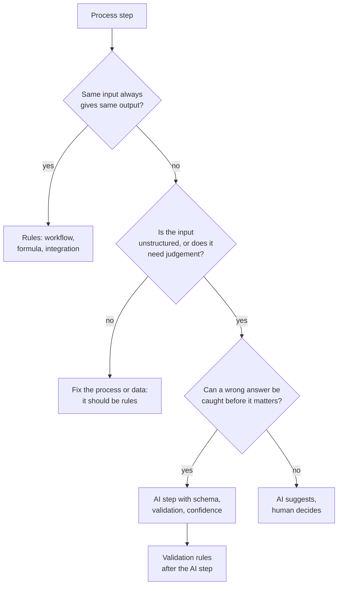

<!-- Changelog: 2026-11-08 (v0.1.0) -- Phase 2 build per ai-automation blueprint. -->

Read `../_shared/engagement-conventions.md` first.

# AI Agents and Process Automation

This is the department's build method for automations and agents across every industry: what to
automate, which kind of automation, how much autonomy, what controls, and how it is run once it
is live. The client buys hours removed, manual steps eliminated and systems connected, with the
risk controlled. They are not buying "an agent". If plain rules do the job, plain rules win.

## Department relationships

- **Invoked by** `ai-manager` (stage 3 design input and stage 5 build), and loaded by the
  `ai-engineer` agent when it builds an automation or agent.
- **Inputs**: discovery notes and the qualified use case (`ai-discovery-scoping`, patterns P1, P3,
  P4, P5, P6, P8 in `../ai-discovery-scoping/references/solution-patterns.md` there), the risk tier and threat model
  (`ai-compliance-risk`), the solution design (`ai-architect` agent following
  `ai-solution-architecture`).
- **Hands to**: `n8n/n8n-architect` for every n8n workflow build (this skill specifies; n8n-architect
  builds, validates and deploys); `product/product-builder` for anything with a user interface
  (approval consoles, portals, dashboards); `ai-rag-engineering` (another agent is writing it)
  when an agent needs company knowledge; `ai-deployment-platforms` (same) for hosting;
  `ai-evals-security-testing` for the eval baseline and red-team before go-live;
  `ai-optimisation-llmops` for the monthly loop after go-live;
  `ai-compliance-risk` mode (h) for the go-live sign-off.

## Protocol

1. **Confirm the gate.** A risk tier exists (conventions s2). No tier, no design. Tier 4, stop.
2. **Select the process and the technique** (`references/process-selection.md`). Map every step
   of the current process, then mark each step: rules, AI (judgement or unstructured input),
   human, or remove. AI only where a rule cannot do it reliably.
3. **Pick the pattern** (`references/automation-patterns.md`): document intake, email triage,
   CRM automation, data enrichment, AP invoice capture, reconciliation support, quote generation,
   support agent, back-office agent, voice agent.
4. **Set the human-in-the-loop tier** per action (below). The risk tier sets the floor.
5. **Write the agent control spec** (`templates/agent-control-spec.md`) for anything that can
   act: tools, permissions, approvals, limits, kill switch, logs, failure handling. Walk
   `references/agent-controls.md` against OWASP ASI01-ASI10 by ID.
6. **Route the build**: n8n workflow to `n8n-architect`; code agent or voice logic to
   `ai-engineer`; UI to `product-builder`. Sandbox or staging only (conventions s2).
7. **Define run requirements**: monitoring, alerting, error queue owner, runbook
   (`templates/automation-runbook.md`). No go-live without a named person who handles exceptions.
8. **Verify and hand over**: eval baseline and security tests (`ai-evals-security-testing`),
   compliance sign-off, then the client's accountable owner approves go-live in writing.

## Rules first, AI second

Typical AI steps: reading a PDF or email, classifying free text, extracting fields from varied
layouts, drafting a reply, summarising a call, matching fuzzy records. Typical rules steps:
routing by a field value, calculations, lookups, date logic, notifications, writing a validated
record through an API. Most good automations are mostly rules with one or two AI steps inside.

## Human-in-the-loop tiers (research B5)

| HITL tier | Pattern | Use for |
|---|---|---|
| H1 | Human does, AI suggests | Tier 3 decisions about people; anything novel; first weeks of any new automation |
| H2 | AI does, human approves each action | Irreversible, financial or customer-facing actions; writes to a system of record until the eval proves accuracy |
| H3 | AI does, human samples and can override | Proven, reversible, internal actions with a measured error rate the owner accepts |
| H4 | Autonomous within hard limits | Low-impact, reversible, internal actions with caps and a kill switch |

The risk tier sets the floor: tier 3 starts at H1 or H2 for the decision path; tier 2
customer-facing output starts at H2 until the eval baseline supports H3. Moving down a tier
(more autonomy) needs eval evidence and the accountable owner's written approval.

**A human approving each action does not by itself settle the APP 1.7 question.** If the AI
output is substantially and directly related to a decision that could significantly affect an
individual, using their personal information, the privacy policy disclosure applies from
10 December 2026 -- unless the program's role is reduced by extensive human oversight and
control, which is a judgement call, never an assumption (register AU-8; the qualified test and
the OAIC's own wording are in `ai-compliance-risk/references/adm-check.md`). Run the ADM check
in `ai-compliance-risk` mode (c).

## Least agency (non-negotiable for anything that acts)

Every agent and every automation with write access gets, at minimum: its own scoped, short-lived
credential stored in Doppler; a tool allow-list with parameter validation; human approval for
irreversible, financial or customer-facing actions; spend, rate and loop caps; a kill switch the
client can use without the practice; full action logging; idempotent writes; retries with backoff; an
error queue with a named owner. Detail and the OWASP ASI mapping: `references/agent-controls.md`.
ACSC "Careful adoption of agentic AI services" (May 2026, register AU-23) is the Australian
reference to cite to clients.

## Voice agents

Inbound first. Build options Pipecat (BSD-2-Clause) or LiveKit Agents (Apache-2.0) on Australian
infrastructure; buy options are hosted voice platforms (the practice's own receptionist runs on Retell
with a Twilio AU number via SIP import). Every voice agent has an AI disclosure and recording
notice at the start of the call, an escalation path to a human, and a public-safe knowledge base.
Recording consent requirements by state are **PENDING_VERIFICATION** (no register row yet): no
client voice agent goes live until the client's legal adviser has confirmed the script for every
state the callers are in. Detail: `references/voice-agents.md`.

## Hand-offs

| Build type | Goes to | What this skill hands over |
|---|---|---|
| n8n workflow (triggers, connectors, LLM steps, approvals) | `n8n/n8n-architect` | Process map, step classification, agent control spec, error-queue design, runbook skeleton |
| Agent in code, voice agent logic, eval harness | `ai-engineer` agent | Same, plus the solution design and eval set source |
| Approval console, portal, dashboard, any UI | `product/product-builder` (stack via `product/app-stack-decision`) | Spec of the screens the approver needs, roles, audit needs |
| Knowledge retrieval for the agent | `ai-rag-engineering` | Sources, permissions, who may see what |
| Client on Odoo | `odoo/odoo-consultant`, AI layer `odoo-automation` | Process map and controls |

## Industry use cases

`references/industry-use-case-library.md` maps automation and agent patterns to each of the
twelve industry packs in `../_shared/industry-packs/`. Use cases there are practitioner
synthesis; never quote a saving from them. Get the client's own numbers.

## Output conventions

- Agent control spec and process map in the client's `created/docs/strategy/`
  (`agent-control-spec-{process}-{YYYY-MM-DD}.md`); runbook in `created/docs/handover/`
  (`automation-runbook-{process}-{YYYY-MM-DD}.md`).
- Mermaid for process maps and control diagrams. Plain English in anything the client reads.
- Credentials only in your secrets manager, one project or scope per client.
- Log the action to your own engagement activity log.

## Do not

- Do not use AI for a step a rule can do. Do not use an agent where a fixed workflow will do.
- Do not let an automation send, pay, delete or post to a customer without an approval step
  until the eval and the owner say otherwise, in writing.
- Do not share one credential across agents, or give an agent the human user's own login.
- Do not build on client production, send real customer messages, or move real money in testing.
- Do not state a voice recording or telemarketing rule from memory; it is PENDING_VERIFICATION.

## Known gaps (v0.1.0)

- Call recording and listening-device rules per state: no register row (GitHub research gap 9).
- Outbound AI calling (telemarketing rules) not covered; inbound only until a register row exists.
- No worked client example yet beyond the practice's own receptionist.

Provenance: `references/vendored-provenance.md`.
