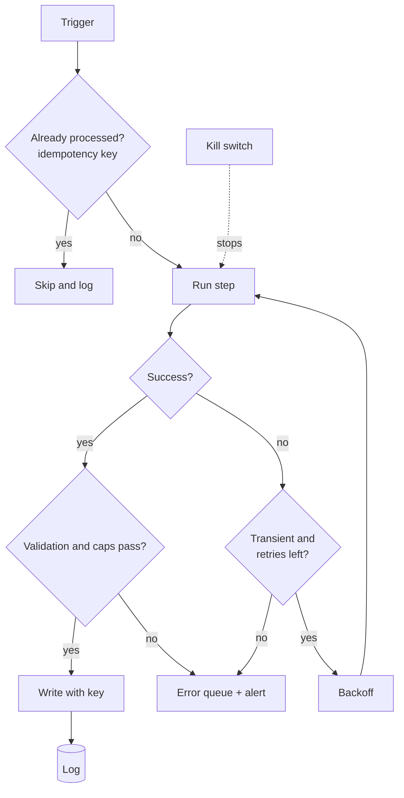

# Agent and automation controls (least agency)

*v0.1.0, 2026-11-08. Control set from the Internal web research B5 (OWASP Agentic Top 10 2026, ACSC
"Careful adoption of agentic AI services" May 2026) and `ai-compliance-risk/references/threat-model.md`.
OWASP lists are CC BY-SA 4.0 (https://creativecommons.org/licenses/by-sa/4.0/): **IDs only are cited here**, in DDD's own words. Essential Eight mapping
is DDD interpretation (research A1), not a quoted ASD position.*

"Least agency" is the unifying principle of the OWASP Agentic Top 10 (register INT-10): an agent
gets the smallest set of tools, permissions and autonomy that does the job, and nothing more.

## 1. The control set

| # | Control | What it means in practice | Main IDs it addresses |
|---|---|---|---|
| C1 | Scoped credentials | One service account or API key per agent or workflow, least privilege, short-lived where the platform allows, stored in Doppler, never the human user's own login | ASI03, LLM03:2026 |
| C2 | Tool allow-list | The agent can call only listed tools; each tool validates its parameters (types, ranges, allowed values); no general "run any query" or "call any URL" tool | ASI02, LLM03:2026 |
| C3 | Read before write | Read tools and write tools separated; write tools fewer and more tightly scoped | ASI02, ASI03 |
| C4 | Human approval | Required for irreversible, financial or customer-facing actions (payments, sends, deletions, public statements, record status changes that trigger downstream effects) | LLM03:2026, ASI09 |
| C5 | Approver protection | The approval screen shows the raw facts (amounts, recipients, the source document), not only the agent's summary, so an approver cannot be talked into a bad action | ASI09 |
| C6 | Spend, rate and loop caps | Per-run and per-day caps on tokens, cost, tool calls, records changed and loop iterations; breach stops the run and alerts | LLM06:2026, ASI08 |
| C7 | Kill switch | One documented action, usable by the client without DDD, that stops the agent immediately (disable the workflow, revoke the credential) and is tested before go-live | ASI10 |
| C8 | Untrusted input handling | Email bodies, documents, web pages and retrieved text are data, never instructions; they cannot change the agent's goal or the allow-list | ASI01, LLM01:2026 |
| C9 | Output handling | Model output is validated against a schema before any system uses it; never executed or rendered as HTML unchecked | LLM10:2026, ASI05 |
| C10 | Sandboxed execution | Any generated code runs in an isolated sandbox with no credentials and no network beyond what is needed | ASI05 |
| C11 | Memory hygiene | Per-user or per-case memory; no shared memory that one user's input can poison for another | ASI06 |
| C12 | Agent-to-agent | If several agents exist, messages pass through logged, authenticated channels (or the orchestrator), and one agent's output is validated before another acts on it | ASI07, ASI08 |
| C13 | Pinned supply chain | Models, tools, MCP servers and packages pinned to versions, from known publishers, reviewed before upgrade | ASI04, LLM04:2026 |
| C14 | Full action logging | Every run logs: trigger, inputs (redacted as needed), model and prompt version, tool calls with parameters, outputs, approvals (who, when), errors, cost | All; incident response |
| C15 | Idempotency | Every write carries an idempotency key (source ID + action) so a retry or re-run never creates a duplicate invoice, email or record | ASI08 |
| C16 | Retries and backoff | Transient failures retried with backoff and a maximum count; permanent failures not retried | ASI08 |
| C17 | Error queue | Anything that fails validation, exceeds a cap or exhausts retries goes to a queue with a named owner, an alert, and a target time to clear | ASI08 |
| C18 | Monitoring | Volume, success, exception and approval rates, cost, latency, watched against expected ranges with alerts (detail in the runbook) | ASI10, LLM06:2026 |

Minimum by risk tier: tier 1 automations with no write access need C8, C9, C14. Anything that
writes needs C1, C2, C6, C7, C14 to C17. Customer-facing or financial adds C4 and C5. Tier 3 adds
the full set plus a red-team in `ai-evals-security-testing`.

## 2. Essential Eight touchpoints (interpretation)

Agent service accounts fall under restricting administrative privileges; agent hosts under
patching and application control; DDD and client admin access to the automation platform under
MFA; workflow definitions and configuration under regular backups. A security review maps agent
permissions to the client's target E8 maturity level.

## 3. Failure handling design

Decide per step whether failure is recoverable (retry, fall back to a human lane) or fatal (stop
the run, alert). Partial runs must leave systems consistent: write to staging then commit, or make
every write individually idempotent so a re-run is safe.

## 4. Testing the controls (before go-live)

Each control gets at least one test case in `ai-evals-security-testing`:
injected instructions in an inbound email (C8); a tool call with out-of-range parameters (C2); a
run that exceeds the cap (C6); the kill switch used by the client contact (C7); a duplicate
trigger (C15); a forced downstream outage (C16, C17); an approval screen review by a real
approver (C5).
