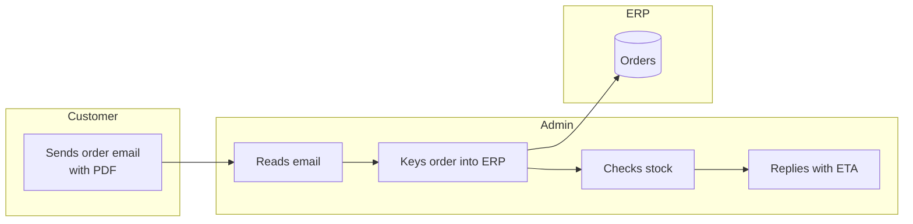

# Process selection: what to automate, and with what

*v0.1.0, 2026-11-08. House method. Builds on `ai-discovery-scoping/references/use-case-qualification.md`
(value, feasibility, gates) and `n8n/n8n-architect` assess mode (frequency, predictability, data,
API access, complexity). This file adds the step-level decision: rules, AI, human or remove.*

## 1. Is the process worth automating?

Use the qualification file for value and gates. In addition, a good automation candidate has:

| Signal | Good candidate | Poor candidate |
|---|---|---|
| Frequency | Daily or weekly, steady volume | A few times a year |
| Shape | Same steps most of the time, known exceptions | Every case different |
| Inputs | Arrive digitally (email, form, file, API) | Paper, phone notes, memory |
| Systems | API or reliable export on both ends | Locked system, no vendor support |
| Owner | Someone who will test it and handle exceptions | "IT will look after it" |
| Failure cost | Caught before it hurts (validation, review) | Wrong output reaches a customer or a payment unseen |

A poor fit on "shape" usually means the process needs fixing first. Automating a messy process
makes the mess faster.

## 2. Map the current process step by step

Draw it as the people doing it describe it, not as the procedure manual says. One swim lane per
role or system. Mark for each step: input, output, system, time taken, how often it goes wrong.

## 3. Classify every step

| Class | Test | Examples |
|---|---|---|
| **Remove** | Nobody uses the output, or it duplicates another step | Re-keying into a second spreadsheet; manual "check" nobody records |
| **Rules** | Same input, same output, every time; logic can be written down | Routing by customer code, totals, date maths, lookups, notifications, API writes of validated data |
| **AI** | Input is unstructured (free text, PDFs, scans, speech) or needs judgement a person can describe and check | Extract fields from varied invoice layouts; classify an email's intent; draft a reply; summarise a call; fuzzy match a supplier name |
| **Human** | Needs accountability, empathy, negotiation, or a decision with significant effect on a person | Approve a refund over a limit; decide a claim; handle a complaint escalation; final hiring decision |

Then check the AI steps:

1. **Could a rule do 80% and AI only the remainder?** Often yes: match on ABN or PO number by
   rule first, use AI only when the rule fails.
2. **Is the AI output checked by a rule afterwards?** Extraction gets validated (totals add up,
   supplier exists, PO matches). Classification gets a confidence threshold and an "unsure" lane.
3. **Is the output schema fixed?** AI steps return structured data against a schema, never free
   text that the next step parses.
4. **Where is the human?** Set the HITL tier per action (SKILL.md table).

## 4. Choose the technique

| Shape of the work | Technique | Notes |
|---|---|---|
| Fixed sequence, a few AI steps inside | Workflow (n8n) with LLM nodes | The default. Predictable, testable, cheap to run. Build via `n8n-architect` |
| Fixed sequence, no AI | Workflow or the client's own platform automation | Check the client's existing tools first (CRM, ERP, M365 have native automation) |
| Needs to choose among several tools depending on the case | Agent with an allow-listed toolset | Only when the path genuinely varies; every tool scoped; approvals on writes |
| Several agents passing work to each other | Multi-agent | Rarely justified for SME processes; adds ASI07 and ASI08 exposure. Prefer one agent plus workflow |
| Conversation with customers (text) | Support agent with human handoff (pattern P3) | Customer-facing: tier 2 minimum |
| Conversation by phone | Voice agent (pattern P4) | See `voice-agents.md` |

Gartner predicts over 40% of agentic AI projects will be cancelled by end of 2027 due to cost,
unclear value or inadequate risk controls. Attribution `PENDING_VERIFICATION`: our research file dated this
25 June 2025, but the Gartner release both files cite elsewhere is 26 May 2026 (https://www.gartner.com/en/newsroom/press-releases/2026-05-26-gartner-says-applying-uniform-governance-across-ai-agents-will-lead-to-enterprise-ai-agent-failure),
and neither carried a figure-level URL. Re-read it from Gartner before quoting it to a client. Use it to justify starting
narrow with a workflow, not as a scare line.

## 5. Write down the not-automated parts

Every process map ends with the steps that stay manual and why. Clients remember what was
promised; an explicit list prevents "I thought it would do that too".
