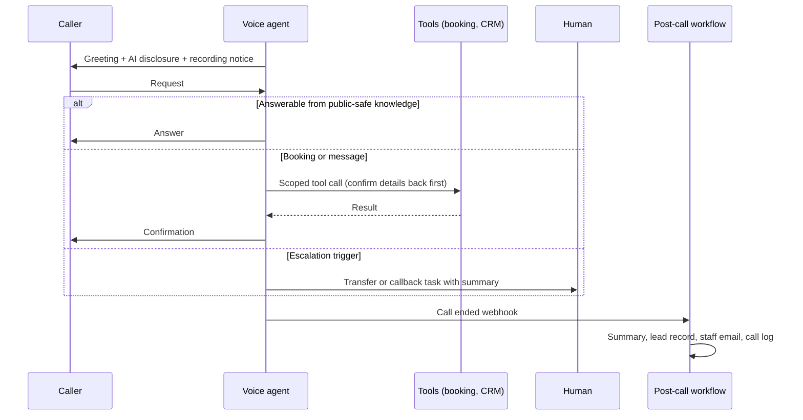

# Voice agents

*v0.1.0, 2026-11-08. Sources: solution pattern P4 in `ai-discovery-scoping`; GitHub research
area 6 (Pipecat BSD-2-Clause, LiveKit Agents Apache-2.0) and gap 9 (nothing public covers call
recording consent, disclosure scripts and escalation under Australian law); DDD's own receptionist
build (`DDD Clients/Projects/ai-receptionist/CLAUDE.md`, verified 2026-08-13). No platform
prices or features are stated here: check vendor docs at design time (R1).*

## 1. Where voice agents fit

Missed calls that cost leads or bookings; after-hours and overflow; simple enquiries; booking and
message capture. Inbound only for now. Outbound AI calling raises telemarketing and consent rules
that have no register row: **PENDING_VERIFICATION**, out of scope until a row exists.

Avoid legal, health and government callers until a sovereign stack exists (DDD product decision
recorded in P4). Typical risk tier 2 (personal data, recordings, customer-facing).

## 2. Build or buy

| Option | What it is | When | Notes |
|---|---|---|---|
| Buy: hosted voice platform | Vendor hosts speech-to-text, the model and text-to-speech; you supply prompt, knowledge and tools | Speed; S and M clients; low-sensitivity calls | DDD runs Retell (agent) with a Twilio AU number via elastic SIP import, plus an n8n post-call pipeline. Retell's own number purchase was US/CA only when verified (2026-08-13), so AU numbers come via SIP import. Vapi is DDD's noted fallback. Check each vendor's data region and retention terms (vendor due diligence, `ai-compliance-risk` mode g) |
| Build: Pipecat (BSD-2-Clause) | Open-source voice agent framework | Data sovereignty, custom logic, cost control at volume | Hosted on Australian infrastructure; DDD's phase 3 sovereignty plan (with a self-hosted telephony gateway under evaluation) |
| Build: LiveKit Agents (Apache-2.0) | Open-source realtime voice agents with telephony | As Pipecat; examples include receptionist-style agents | Same hosting considerations |

The prompt, knowledge base and post-call workflow should be platform-neutral so a platform swap
is days, not a rebuild (DDD receptionist decision).

## 3. Call design

**Opening script elements** (wording confirmed by the client's legal adviser per state):
who the caller has reached; that they are speaking with an AI assistant; that the call is
recorded or transcribed and why; how to reach a person.

**Recording consent:** state and territory listening-device and surveillance Acts are named in
the research overlay table but have no verified register row. Requirements differ by
jurisdiction and are **PENDING_VERIFICATION**. Do not tell a client their script is compliant.
The statutory tort for serious invasions of privacy (register AU-7, in force) is relevant to
recording; the APPs (AU-6) govern the personal information collected.

**Escalation triggers** (minimum): caller asks for a person; distress, complaint or vulnerability
signals; emergency language (direct to emergency services per the client's script); low
confidence twice in a row; anything about price commitments, refunds, legal or medical matters;
repeated misunderstanding.

**Never**: transfer to a number that forwards back to the agent (call loop; DDD's receptionist
rule); let the agent quote prices or commitments not provided by a rule-backed tool; put client
names, fees or internal systems in a knowledge base that is spoken to the public.

## 4. Controls specific to voice

- Public-safe knowledge base only; reviewed by the client before go-live.
- Booking tools confirm details back to the caller before writing; current date injected before
  any date reasoning (DDD receptionist queued upgrade).
- Recordings and transcripts: retention period set with the client; stored in the region the
  design states; access limited.
- Eval calls covering every call type, escalation trigger and an attempt to make the agent
  ignore its instructions (LLM01:2026) before go-live.
- Post-call summary reaches a human within an agreed time; missed summaries alert.

## 5. Effort drivers (for ai-proposal-pricing)

Booking or CRM integration; transfer logic; number of call types; recording consent work per
state; number porting and carrier set-up; languages and accents to test; after-hours routing.
