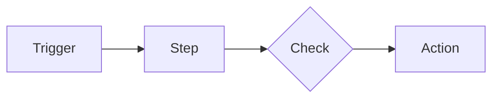

<!-- Audience: internal + client technical owner. One spec per automation or agent. Save as
{client}/created/docs/strategy/agent-control-spec-{process}-{YYYY-MM-DD}.md. Changes after
go-live get a new dated version, never an in-place edit. -->

# Agent control spec: {automation or agent name}

| Field | Value |
|---|---|
| Client | {client} |
| Process owner (handles exceptions) | {name, role} |
| Accountable owner (approves go-live and autonomy changes) | {name, role} |
| Risk tier (from ai-compliance-risk, date) | {1-3}, screened {date} |
| ADM check result (APP 1.7, date) | {in scope / not in scope}, {date} |
| Pattern | {document intake / email triage / CRM / enrichment / AP / reconciliation / quote / support / back-office / voice} |
| Platform and region | {n8n on ..., model provider and region; verified {date} with source URL} |
| Version of this spec | v{n}, {date} |

## 1. Purpose and boundary

What it does, in two sentences. What it must never do (explicit list).

## 2. Process map

Steps classified: rules / AI / human (see `references/process-selection.md`).

## 3. Tools and permissions

| Tool | Read or write | System and scope | Credential (Doppler key name, not the value) | Parameter limits | HITL tier |
|---|---|---|---|---|---|
| {e.g. get_open_POs} | Read | ERP purchase orders, company X only | {DOPPLER_KEY_NAME} | supplier_id must exist | H4 |
| {e.g. create_draft_bill} | Write | Accounting, draft bills only | {DOPPLER_KEY_NAME} | amount <= {cap}; no bank detail fields | H2 |

Anything not in this table is not allowed. No tool can run arbitrary queries, call arbitrary URLs
or send to arbitrary recipients.

## 4. Approvals

| Action | Approver (role) | What the approver sees | Timeout behaviour |
|---|---|---|---|
| {send customer email} | {role} | {raw facts: recipient, full text, source record} | {stays in queue; alert after N hours} |

## 5. Limits

| Limit | Value | On breach |
|---|---|---|
| Max runs per hour / day | {n} | Stop and alert |
| Max records written per run | {n} | Stop and alert |
| Max model cost per day (AUD) | {n, from the run-cost estimate} | Stop and alert |
| Max tool calls / loop iterations per run | {n} | Stop that run, error queue |

## 6. Kill switch

- Action: {exactly what to click or run, e.g. deactivate workflow X; revoke key Y}
- Who can use it: {client role(s) and the practice}
- Tested on: {date, by whom, result}
- After use: {what happens to in-flight items; how to restart safely}

## 7. Inputs treated as untrusted

{Email bodies, attachments, web content, retrieved documents, caller speech.} None of these can
change instructions, tools or limits. Test cases: {refs}.

## 8. Logging

| Logged | Where | Retention | Who can read |
|---|---|---|---|
| Trigger, inputs (redacted: {fields}), model + prompt version, tool calls + parameters, outputs, approvals, errors, cost | {system} | {period agreed with client} | {roles} |

## 9. Failure handling

| Failure | Retry? | Then |
|---|---|---|
| {transient API error} | Yes, {n} times with backoff | Error queue + alert |
| {validation fails} | No | Human review queue |
| {duplicate trigger} | n/a | Skipped by idempotency key {key format} |

Error queue: {location}, owner {name}, target time to clear {n hours}, alert channel {channel}.

## 10. OWASP walk (IDs only)

| ID | Applies? | Control(s) in this spec | Test ref |
|---|---|---|---|
| LLM01:2026 / ASI01 | | C8 | |
| LLM10:2026 | | C9 | |
| LLM03:2026 / ASI02 / ASI03 | | C1-C4 | |
| LLM06:2026 | | C6 | |
| ASI04 | | C13 | |
| ASI05 | | C10 | |
| ASI06 | | C11 | |
| ASI07 / ASI08 | | C12, C15-C17 | |
| ASI09 | | C5 | |
| ASI10 | | C7, C18 | |

## 11. Autonomy changes

Moving any action to a less supervised HITL tier needs: eval evidence (link), error rate over
{window}, and the accountable owner's written approval (date). Record each change here.
