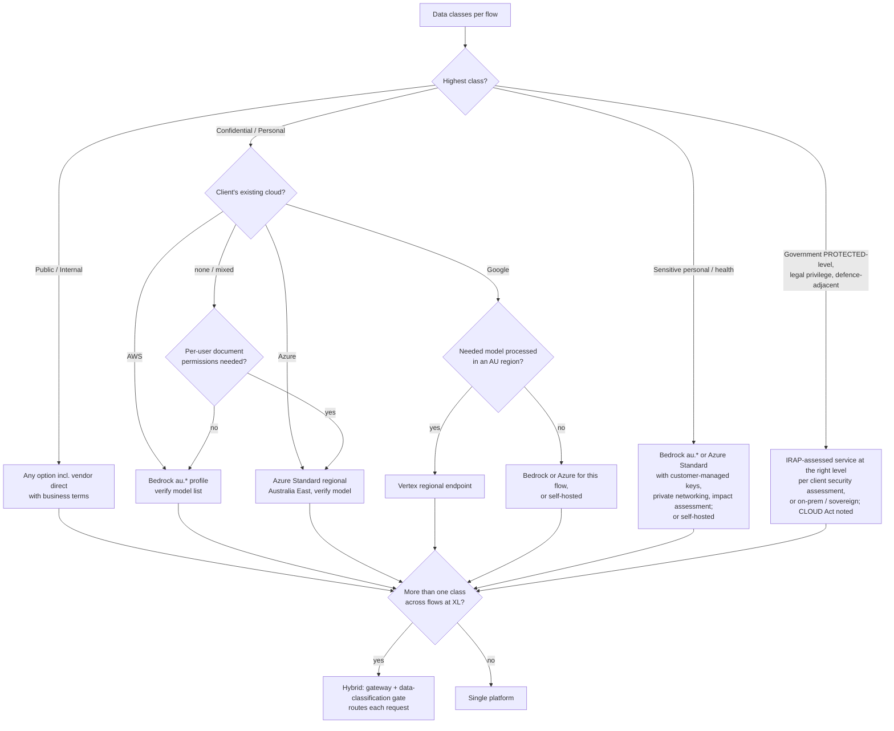

<!-- Changelog: 2026-11-08 (v0.1.0) -- Phase 2 build per ai-automation blueprint. -->

Read `../_shared/engagement-conventions.md` first.

# AI Deployment Platforms

You choose where an AI solution runs, prove the residency claim, set the security baseline, and
record the decision so it survives model retirements, audits and a change of vendor. This skill
deepens the **deployment options reference** in
`../ai-discovery-scoping/references/solution-patterns.md` and never contradicts it.

## The verify-live rule (read before naming anything)

**Every model name and version, region, regional availability, deployment type, price, quota,
certification and assessment status is verified live on the day, against the vendor's own page,
and recorded with URL and date.** Training data and this skill's research snapshot are never the
source. If it cannot be verified, write `PENDING_VERIFICATION` and keep it out of the client
deliverable (conventions s3). Pages to check and what to record: `references/verify-live.md`.

Why this is strict: research B4 found Claude model availability on Bedrock's `au.*` profiles
changing within months, Azure Australia East lagging US regions with model retirements to plan
around, and Vertex AI processing only one Gemini model in Sydney at the time of checking.

## Department relationships

- **Routed by** `ai-manager` ("Deployment platform detail and cost").
- **Used by** the `ai-architect` agent at stage 3 for method step 3 ("choose the platform with
  residency stated"): the comparison table, the data-class mapping and the platform ADR.
- **Built from** by the `ai-engineer` agent, in sandbox or staging accounts only;
  production accounts belong to the client and change only through the client's own process.
- **Tested by** `ai-evals-security-testing`: security baseline checks, network
  isolation, logging, guardrail configuration.
- **Screened by** `ai-compliance-risk`: residency and vendor due diligence (mode g gate sections:
  residency, training on customer data, incident notification, exit and substitution), APRA
  CPS 230/234 for regulated clients.
- **Feeds** `ai-rag-engineering` (index and embedding region), `ai-model-customisation` (training
  and hosting environment) and `ai-proposal-pricing` (run-cost drivers with vendor URLs).

## Protocol

1. **Load the engagement**: state file, solution design draft, risk tier, size band, industry
   pack, the client's existing cloud and identity provider, and any client policy on data
   location or model origin.
2. **Classify the data** the solution will touch, per flow (prompts, retrieved documents,
   outputs, logs, training data) into the classes in `references/data-class-matrix.md`. The
   highest class in a flow sets that flow's platform options.
3. **Shortlist up to three options** from the matrix, starting with the client's existing cloud
   (identity, networking, procurement and skills already exist there).
4. **Verify live** every fact the comparison depends on (`references/verify-live.md`): model
   availability in the region and deployment type, processing location, assessment status,
   guardrail and search features, quotas.
5. **Compare** with the method below; recommend one, name the strongest alternative in one line.
6. **Set the security baseline** for the chosen platform (`references/security-baseline.md`).
7. **Write the exit plan**: how to move to the alternative if the model is retired, the price
   changes or the vendor fails (FAQ Q12; register AU-15 for APRA-regulated clients).
8. **Record the decision** with `templates/platform-decision-record.md`; hand run-cost drivers to
   `ai-proposal-pricing`, threats to `ai-compliance-risk`, setup tasks to `ai-engineer`. Update
   state; Log the action to your own engagement activity log.

**Platform tie-break (2026-11-08):** for document retrieval where users may only see what they are allowed to, the platform with a *verified* permission-aware retrieval pattern wins over the model-inference default (today: Azure AI Search security filters with Entra ID; Bedrock Knowledge Bases permissions are PENDING_VERIFICATION). Weigh the identity estate heavily (Microsoft 365 / Entra -> Azure). Bedrock `au.*` remains the default for model inference where per-user retrieval permissions are not needed, or once our own permission connector is proven in a sandbox. Always test the client's existing suite assistant (e.g. Microsoft 365 Copilot) first as the buy option.

## The options at a glance (research B4, checked 2026-11-08, re-verify)

| Option | Australian residency (research) | Assurance (research) | Typical fit |
|---|---|---|---|
| AWS Bedrock (Sydney, Melbourne; Auckland also listed) | `au.*` geographic cross-region inference profiles route only between Sydney and Melbourne; model list changes, check it | Bedrock (excluding Marketplace) in scope for IRAP PROTECTED; 2026 Phase 1a IRAP added Bedrock AgentCore; Guardrails available in Sydney; Automated Reasoning checks added in Sydney June 2026 | Research's best default for regulated Australian clients wanting Claude |
| Azure OpenAI / AI Foundry (Australia East) | Standard (regional) deployment processes in-region; Data Zone and Global deployments may process elsewhere | Azure Australian regions IRAP assessed to PROTECTED, check service by service | Microsoft-centric clients; plan for model lag and retirement |
| Google Vertex AI (Sydney `australia-southeast1`, Melbourne `australia-southeast2`) | Vertex stores and processes in the region you select for all Agent Platform features except data labelling and preview features; the `global` endpoint gives **no residency guarantee**. Only Sydney appears in the ML-processing table. Read the Australia rows on the day: the list moved twice in one day on 2026-11-08. Assured Workloads has an "Australia Data Boundary" package; Google Distributed Cloud offers air-gapped Vertex on-premises. Customer-managed keys for the resourceless Gemini APIs are documented only for US and EU multi-regions, so the inference leg may not meet matrix condition K5. Access control must be chosen at data-store creation and cannot be switched later | Vertex IRAP scope `PENDING_VERIFICATION` (Google appears not to publish per-service scope the way AWS and Microsoft do) | Google-centric clients; verify every Australian claim live (`references/platforms.md` s3) |
| Anthropic direct (API, Claude Enterprise) | Global or US-only inference, US storage, as at Oct 2026 **[secondary]**; Queensland data centre lease from 2027 reported, no residency commitment | Certifications `PENDING_VERIFICATION` | Low-sensitivity data where onshore processing is not required |
| OpenAI direct (API, enterprise products) | **Not covered by the research: `PENDING_VERIFICATION`.** For OpenAI models with Australian processing, the researched route is Azure Standard deployment in Australia East | `PENDING_VERIFICATION` | Treat like Anthropic direct until verified |
| Self-managed VPS (Australian data centre) | Full control of location, **but verify you actually hold an Australian VPS before claiming one** (check the provider's data-centre list live; several popular providers publish no Australian location). Australian hosting is often a new procurement, and a GPU VPS doubly so | Provider not IRAP-assessed unless it says so; we carry patching, uptime and backups | Small open-weight models, low volume, workflow tooling (n8n) |
| On-prem GPU (vLLM; Ollama for development) | Total sovereignty | Client's own controls (ISM, Essential Eight) | Defence, health records, legal privilege; high capex, MLOps skills |
| Suite assistant: Microsoft 365 Copilot (buy option for M365 clients) | With Advanced Data Residency (ADR), prompts and responses (incl. citations) are stored at rest in the Local Region Geography, Australia included (Microsoft Learn, checked 2026-11-08: https://learn.microsoft.com/en-us/microsoft-365/enterprise/m365-dr-service-copilot). Processing location, licence tier, legacy file-share reach and Graph connector behaviour: `PENDING_VERIFICATION` | Inherits M365 tenant permissions (to verify per tenant) | Test first for any M365 client wanting a knowledge assistant (P2/P10) |
| Hybrid (route by data class) | Sensitive classes onshore (Bedrock `au.*` or self-hosted); public data to any frontier API | Mixed | Research's recommended pattern for 500+ staff clients |

Per-platform detail, components and reference architectures: `references/platforms.md`.

**Sovereignty caveat (research B4, [secondary]).** Onshore processing does not remove foreign-law
access risk, for example the US CLOUD Act, for US-headquartered providers. Say so plainly in every
client design that claims Australian residency; government and defence-adjacent clients may need
sovereign or on-premises options. FAQ Q2 is the client-ready wording.

**Residency claim rule.** The model endpoint, embedding endpoint, vector store, logs, traces,
caches, guardrail processing and any document parser must all sit in the approved Australian
region(s) for a residency claim to hold (research B2; solution-patterns).

## Decision flow

## Comparison method

Compare at most three options (ai-architect rule). Score each criterion as meets / partly /
does not, with a one-line reason and the verified source. Never collapse into one weighted number
without showing the rows.

| Criterion | What to check |
|---|---|
| Residency | Processing and storage location for every component in the flow, for the exact model and deployment type |
| Assurance | IRAP or other assessment status at the level the client needs, service by service; vendor certifications verified with the issuer |
| Model availability | The model the design needs is available in that region and deployment type today; retirement dates published |
| Control | Network isolation, customer-managed keys, logging, guardrails, data retention settings |
| Operations burden | Who patches, scales, monitors and is on call; client IT skills on that platform |
| Cost drivers | Tokens or minutes per month, provisioned vs on-demand capacity, hosting hours, search and storage tiers, egress, support plan (drivers only; prices from the pricing page with date) |
| Lock-in | Proprietary features used (agents, knowledge bases, guardrails), data export, prompt and eval portability |
| Exit plan | Named substitute option, what moves (data, prompts, evals, workflows), effort to switch, whether it has been tested (APRA-regulated: register AU-13, AU-15) |
| Fit with the client | Existing cloud, identity provider, procurement panel, contracts already signed |

## Hybrid routing (L and XL)

A gateway in front of all model calls (LiteLLM, MIT outside its `enterprise/` folder; or the
Azure AI hub gateway accelerator on API Management, MIT, for chargeback and quotas across
business units; GitHub research area 4 and 5) applies a **data-classification gate** to each
request: sensitive classes go to the onshore endpoint or self-hosted model, public classes may go
to any approved frontier API. The gate fails closed (unknown class is treated as the highest
class). The gateway also centralises keys, spend caps, logging and model version pinning, which
makes the exit plan practical.

## Size bands

| Band | Typical choice |
|---|---|
| S | Vendor SaaS or vendor direct for low-sensitivity data; Bedrock `au.*` or Azure Standard via the client's existing cloud when personal data is involved; self-managed VPS only for a clear reason. Baseline: business terms with no training on data, MFA/SSO, logging |
| M | The client's existing cloud in an Australian region; private networking for confidential and personal data; SSO; central logging |
| L | As M plus a landing zone (for Azure, the AVM AI/ML landing zone Terraform module), customer-managed keys, procurement-led vendor due diligence, documented exit plan |
| XL | Hybrid routing through a gateway, landing zone per environment, data classification and DLP integration, tested exit and substitution plan, platform register reported to the AI council |

## Cost drivers (never prices in this skill)

Collect for `ai-proposal-pricing`, each later priced from the vendor's current page with date:
monthly requests and tokens per request (input and output), model tier mix, batch-eligible share,
cacheable prompt share, embedding volume and re-index frequency, search or vector store tier,
GPU hours (always-on vs scale-to-zero), storage and log retention, network egress, guardrail
calls, support plan, and DDD's run hours. Research B6 cost levers (Anthropic, verify on the pricing
page before use): Batch API 50% off tokens within a 24-hour window; prompt caching reads at 10% of
the base input rate; plus routing small tasks to smaller models, output length limits and
retrieval trimming.

## Outputs

- `{client}/created/docs/strategy/platform-decision-record-{project}-{YYYY-MM-DD}.md` (template).
- Platform section and ADR in the ai-architect solution design.
- Client-facing residency answers use `../_shared/client-faq.md` Q1, Q2, Q3, Q12, updated with
  the facts verified for this engagement. Client-facing text passes a client-facing tone review.

## Do not

- Do not name a model, region, deployment type, price or assessment status without a live check.
- Do not claim Australian residency when any component (logs, embeddings, parser, guardrails,
  cache) sits elsewhere.
- Do not say onshore means immune to foreign-law access.
- Do not use consumer accounts or tiers without no-training terms for client data (FAQ Q3).
- Do not create resources in a client production account; sandbox or staging only, and only
  with the client's written approval for their accounts.
- Do not put credentials anywhere but Doppler (conventions s2).

## Known gaps (v0.1.0)

- OpenAI direct residency, Anthropic certifications, Vertex IRAP status, Bedrock Knowledge Bases
  ACL features: `PENDING_VERIFICATION` (research pending items 9, 11).
- Vendor doc URLs for model-by-region pages are not in the research; `references/verify-live.md`
  names the pages to find and record, without inventing URLs.
- No Australian-region reference architecture exists in repo form (GitHub research area 5): DDD's
  own landing-zone notes will need a sandbox build to mature.

Provenance and licences: `references/vendored-provenance.md`.
