# Solution pattern catalogue

*v0.1.0, 2026-11-08. Sources: research file `ai-dept-web-research-2026-11-08.md` sections B1-B6
and the industry matrix; GitHub research areas 3, 5, 6. Residency facts were checked by that
research on 2026-11-08; some rest on secondary sources (marked). Re-verify any residency or model
availability claim against the vendor console or docs before it goes in a client design
(conventions s3). Model names are deliberately not listed here: they change monthly.*

## Deployment options reference (used by every pattern)

| Option | Australian residency (per research B4) | Assurance (per research) | Fits |
|---|---|---|---|
| SaaS product (vendor-hosted) | Depends on the vendor; check its data-processing terms and region | Vendor's own (SOC 2, ISO 27001, ISO 42001 claims to be verified per vendor) | S and M, low-sensitivity data, fastest time to value |
| AWS Bedrock (Sydney ap-southeast-2, Melbourne ap-southeast-4) | `au.*` geographic cross-region inference profiles route only between Sydney and Melbourne. Which Claude models are on `au.*` changes; check the current list (research cites an April 2026 list and newer models on the AU profile **[secondary]**) | Bedrock (excluding Marketplace) in scope for IRAP PROTECTED; Bedrock Guardrails available in Sydney | Research's best default for regulated Australian clients wanting Claude |
| Azure OpenAI / AI Foundry (Australia East) | Standard (regional) deployment processes in-region; Data Zone and Global deployments may process elsewhere | Azure Australian regions IRAP assessed to PROTECTED, check service by service | Microsoft-centric clients; model availability in Australia East lags US regions, plan for model retirement |
| Google Vertex AI (Sydney, Melbourne) | Research found only one Gemini model with ML processing in Sydney, none in Melbourne, no Claude in any Australian region; `global` endpoint gives no residency guarantee | Vertex IRAP status PENDING_VERIFICATION | Google-centric clients with low residency needs; weakest AU residency story of the three as at 2026-11-08 |
| Anthropic direct (API, Claude Enterprise) | Global or US-only inference with US storage as at Oct 2026 **[secondary]**; no AU residency commitment announced | Certifications PENDING_VERIFICATION | Low-sensitivity data only where onshore processing is not required |
| Self-managed VPS in an Australian data centre | Full control of location | Client must assess the provider; no IRAP unless the provider is assessed | Small open-weight models, low volume, workflow tooling (n8n) |
| On-premises GPU (vLLM or SGLang; Ollama for development; TGI is archived upstream, not for new builds) | Total sovereignty | Client's own controls (ISM, Essential Eight) | Defence, health records, legal privilege; high capex and needs MLOps skill |
| Hybrid (route by data class) | Sensitive classes to onshore Bedrock or self-hosted; public data to any frontier API | Mixed | Research's recommended pattern for 500+ staff clients; needs a router and a data-classification gate |

Sovereignty caveat (research B4, **[secondary]**): onshore processing does not remove foreign-law
access risk (for example the US CLOUD Act) for US-headquartered providers. Government and
defence-adjacent clients may need sovereign or on-premises options.

Residency claim rule: the vector store, logs and any cache must sit in the same Australian region
as the model for a residency claim to hold (research B2).

---

## P1. Document extraction to system of record

**When it fits.** Repetitive documents in varied formats (invoices, delivery dockets, purchase
orders, application forms, claims, KYC documents) keyed by hand into an ERP, CRM or line-of-business
system. Example: Matthew's Timber keys supplier delivery docket PDFs into Odoo purchase orders by
hand (2026-10-30).

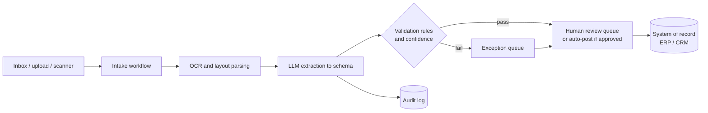

**Deployment.** Any option; regulated documents (KYC, health, claims) point to Bedrock `au.*`,
Azure Australia East standard deployment, or self-hosted. Workflow layer often n8n on an Australian VPS, which
DDD does not currently hold (see P5 deployment note: our own VPS instances are offshore).

**Typical risk tier.** 1-2. Tier 3 if the extracted data drives a decision about a person
(claims, credit, eligibility).

**Build components.** Intake (email/watch folder), OCR or document parser, extraction prompt with a
fixed schema, validation rules (totals, supplier match, PO match), human review step, write to the
system of record via API (writes flagged and approved), exception queue, audit log, eval set of
real documents.

**Effort drivers.** Number of document layouts and suppliers; scan quality; whether the system of
record has a write API; matching logic (to POs, customers); exception rate; write approvals.

**Client questions.** How accurate is it? (Answer from an eval on their own sample, not a vendor
figure.) What happens when it is unsure? (Exception queue, human decides.) Can it post
automatically? (Only after the eval shows it and the owner approves that step.)

## P2. Knowledge assistant over company documents (RAG)

**When it fits.** Staff spend time finding answers in policies, procedures, product manuals,
contracts or past work. For M and above, documents carry different access rights, so retrieval
must be permission-aware.

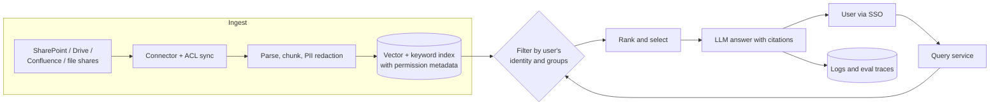

**Deployment.** Vector store and model in the same Australian region for residency. Azure AI
Search supports document-level security filters against Entra principals and Purview sensitivity
labels (research B2). Bedrock Knowledge Bases and Vertex AI Search ACL features are
PENDING_VERIFICATION. SMB tier: simpler stacks without document-level ACLs are acceptable only when
every user may see every document.

**Typical risk tier.** 1 for public or all-staff content; 2 when content includes personal or
confidential information (HR, client files).

**Build components.** Source connectors, ACL and group sync, parsing and chunking, PII redaction
(Presidio has AU recognisers for ABN, ACN, TFN, Medicare per GitHub research), hybrid retrieval,
citation display, SSO, deny-by-default when an ACL is missing, evals for retrieval quality and
groundedness, permission-leak tests (OWASP LLM09:2026, LLM02:2026).

**Effort drivers.** Number of sources; permission complexity and group nesting; ACL sync frequency
and revocation latency target; scanned or image-heavy documents; document volume; language and
table-heavy content.

**Client questions.** Can staff only see what they are allowed to? (Yes if filtered by the user's
identity at query time, never the app's service identity; we test it.) How quickly does a removed
permission take effect? (Revocation latency is a design target we agree and test.) Will it make
things up? (Citations, groundedness evals, "I don't know" behaviour tested.)

## P3. Customer support agent with human handoff

**When it fits.** High volume of repetitive customer questions (order status, policy questions,
bookings) over chat or email, with a clear path to a person.

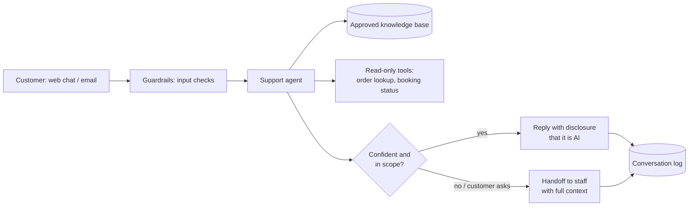

**Deployment.** SaaS helpdesk AI for S/M; Bedrock or Azure in-region for customer data at M+.

**Typical risk tier.** 2 (customer-facing, personal data, human in the loop). Tier 3 if it decides
refunds, claims, credit or eligibility.

**Build components.** Knowledge base curation, retrieval, read-only tool calls, escalation rules
and handoff, AI disclosure wording, guardrails against prompt injection (OWASP LLM01:2026), output
checks against unapproved promises (ACL misleading conduct applies to chatbot statements per the
Treasury review), conversation logging, eval set from real tickets.

**Effort drivers.** Number of tools and systems; write actions (refunds, changes) and approvals;
channels; languages; helpdesk platform; volume.

**Client questions.** Who is responsible if it gives wrong information? (The business, under
existing consumer law; that is why we design handoff and evals.) Will customers know it is AI?
(We recommend disclosure.) Can it process refunds? (Only behind human approval at first.)

## P4. Voice receptionist

**When it fits.** Missed calls cost leads or bookings; after-hours or overflow calls; simple
booking and enquiry capture. DDD runs its own build: Retell agent, Twilio AU number via SIP
import, n8n post-call pipeline (`DDD Clients/Projects/ai-receptionist/CLAUDE.md`).

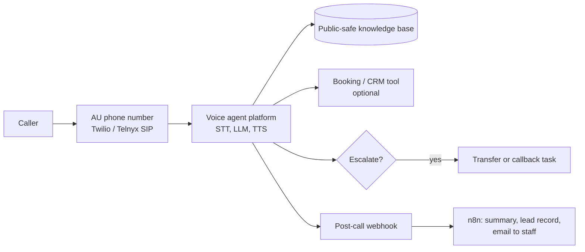

**Deployment.** Hosted voice platforms (Retell, Vapi) for speed; Pipecat or LiveKit Agents on
Australian infrastructure for sovereignty (GitHub research area 6; DDD's phase 3 plan).

**Typical risk tier.** 2 (personal data, recordings, customer-facing). Avoid legal, health and
government until a sovereign stack exists (DDD's own product decision).

**Build components.** Number and carrier routing, agent prompt and persona, public-safe knowledge
base, call recording consent and AI disclosure script, escalation rules, booking or CRM tool,
post-call summary pipeline, call log, eval calls.

**Effort drivers.** Booking integration; transfer logic; number of call types; recording consent
requirements by state (PENDING_VERIFICATION in the regulatory register; GitHub research gap 9
notes nothing public covers this); carrier and number porting.

**Client questions.** Do callers need to be told it is AI and that the call is recorded? (Consent
and listening-device laws apply; confirm with the regulatory register and the client's legal
adviser.) Can it book directly into our calendar? (Yes, as a scoped tool, with a confirmation
step.)

## P5. Workflow automation (n8n)

**When it fits.** Rule-based steps across systems with some judgement in the middle (classify,
summarise, route, draft). Hand detailed builds to the `n8n-architect` skill (n8n department).

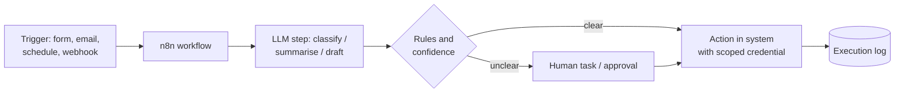

**Deployment.** n8n self-hosted on an Australian VPS (verify live that your provider actually offers an Australian data centre before claiming residency; it may be a new procurement), model per the reference table.
n8n's Sustainable Use Licence restricts reselling n8n as a hosted service (GitHub research); host
per client or use the client's own instance.

**Typical risk tier.** 1-2.

**Build components.** Triggers, connectors, LLM steps with fixed output schema, error handling and
retries, approvals for irreversible actions, credentials in Doppler, execution logging, handover
docs.

**Effort drivers.** Number of systems and steps; write actions; error handling; volume and rate
limits; client-owned vs DDD-hosted instance.

**Client questions.** What happens when a step fails? (Retries, alerts, a human queue.) Who owns
the workflow if we part ways? (Exported workflows and documentation are part of handover.)

## P6. Data enrichment

**When it fits.** Lists or records need cleaning, classifying, de-duplicating or enriching (CRM
records, product catalogues, supplier data, lead lists). DDD's own CRM enrichment pipeline is a
working reference (GitHub research area 6).

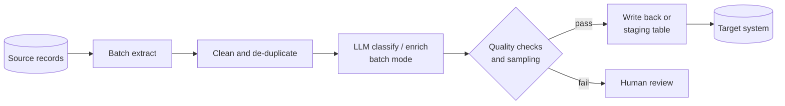

**Deployment.** Batch jobs suit any option; Anthropic's Batch API is 50% off tokens within a
24-hour window (research B6), relevant to run-cost estimates.

**Typical risk tier.** 1-2 (2 if personal information; check whether enrichment from external
sources is a fair collection under the APPs).

**Build components.** Extract, clean, enrichment prompts or external lookups, quality sampling,
staged write-back, audit of changes, rerun schedule.

**Effort drivers.** Record volume, source quality, external data sources and their terms, write-back
rules, frequency.

**Client questions.** Where does enrichment data come from and are we allowed to use it? Can we
undo changes? (Staged write-back with an audit trail.)

## P7. Reporting and natural-language query

**When it fits.** People cannot get answers out of their systems without a specialist. Matthew's
Timber: "what are the sales figures for X customer for August" takes 10-15 minutes and a phone
call (2026-10-30).

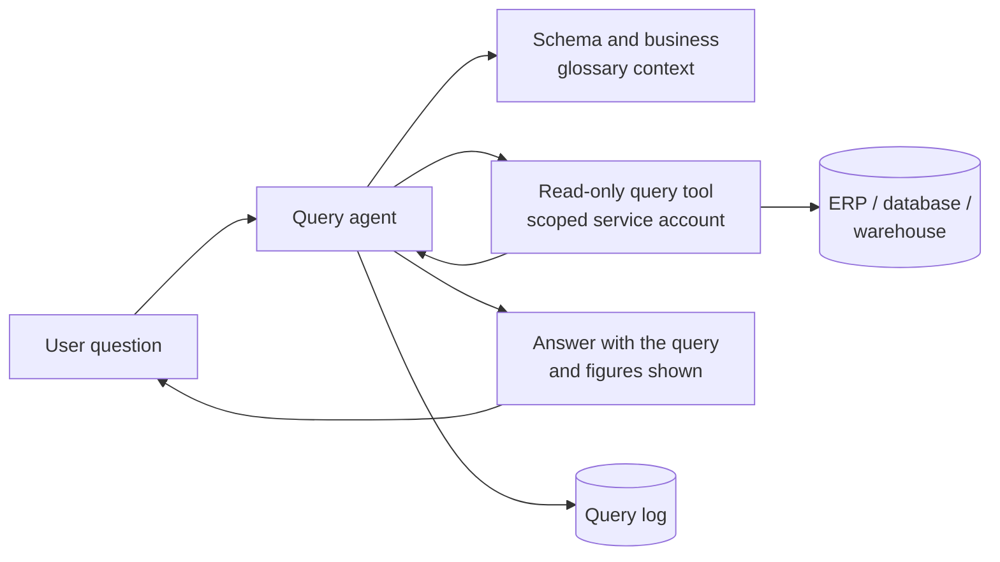

**Deployment.** Close to the data; read-only credentials; model per the reference table.

**Typical risk tier.** 1-2 (2 if the data includes personal information or confidential figures
with role restrictions).

**Build components.** Read-only service account, schema and glossary, query tool, row-level or
role restrictions where needed, answer formatting that shows the query or source, golden question
set with known answers, scheduled report option.

**Effort drivers.** Schema complexity and naming; business definitions (what counts as "sales");
role-based restrictions; system version and API; number of data sources.

**Client questions.** How do we know the number is right? (Golden questions with known answers,
query shown with every answer.) Can it change data? (No, read-only by design.)

## P8. Agentic back-office (least agency)

**When it fits.** Multi-step back-office work that needs several tools and some judgement:
reconciliation preparation, vendor onboarding, order exception handling, scheduling.

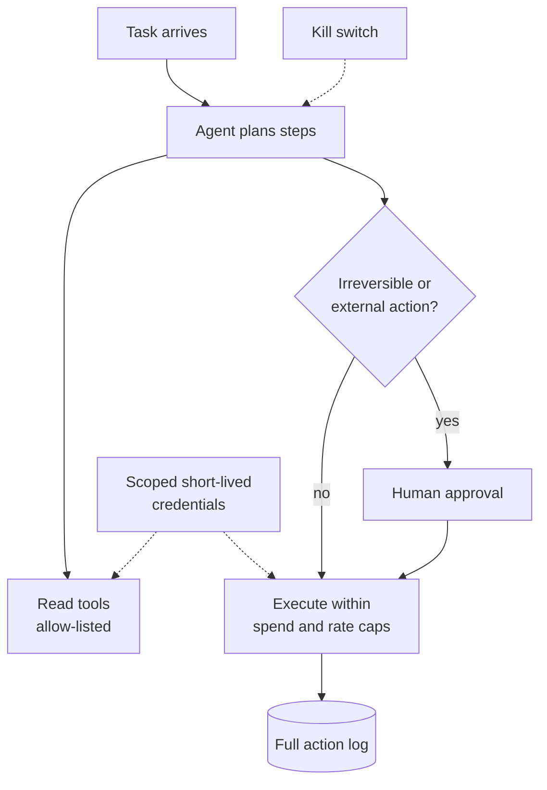

**Deployment.** Same region as the data; AWS Bedrock AgentCore is in the 2026 IRAP report (research
B4). ACSC "Careful adoption of agentic AI services" (May 2026) is the Australian reference.

**Typical risk tier.** 2 at minimum; 3 if it spends money, acts externally or affects people.

**Build components.** Tool allow-list, scoped short-lived credentials per agent, human approval for
irreversible or external actions (payments, emails, deletions, customer-facing statements),
sandboxed code execution, spend and rate caps (OWASP LLM06:2026), kill switch, full action logging,
threat model against OWASP Agentic Top 10 (ASI01-ASI10), eval and red-team suite.

**Effort drivers.** Number of tools and write actions; approval UX; state across steps; failure
recovery; red-team depth.

**Client questions.** What stops it doing something we did not want? (Allow-listed tools, scoped
credentials, approvals, caps, kill switch.) Gartner predicts over 40% of agentic AI projects will
be cancelled by end of 2027 due to cost, unclear value or inadequate risk controls. Attribution
`PENDING_VERIFICATION` (our file says 25 June 2025; the Gartner release cited elsewhere is
26 May 2026, https://www.gartner.com/en/newsroom/press-releases/2026-05-26-gartner-says-applying-uniform-governance-across-ai-agents-will-lead-to-enterprise-ai-agent-failure) -- re-read before quoting to a client:
use it to justify starting narrow, not as a scare line.

## P9. Custom or fine-tuned model

**When it fits.** Rarely first. Only after prompting and retrieval have been tried and measured,
for behaviour, format or style at scale, or when cost or latency of a large model is the
constraint (research B3 decision order: prompt, RAG or tools, fine-tune, distil). Fine-tuning does
not reliably add fresh facts.

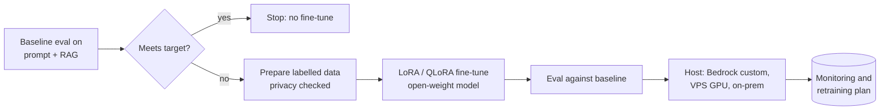

**Deployment.** Self-hosted (VPS GPU, on-premises) or cloud custom-model hosting. Open-weight
licences differ: Llama 4 Community Licence has a 700m monthly active user clause, EU multimodal
limits and naming rules; custom licences (Kimi, GLM) need legal review; some government or
critical-infrastructure clients object to certain model origins by policy (research B3).

**Typical risk tier.** Inherits the use case's tier. Using existing customer data to train or
fine-tune triggers APP 3 and APP 6 limits (OAIC developing-and-training guidance).

**Build components.** Baseline eval, data preparation and privacy review, licence review, training
runs, eval comparison, hosting, monitoring, retraining plan. Detail sits with the planned
`ai-model-customisation` skill.

**Effort drivers.** Labelled data availability; licence and privacy review; GPU hosting; retraining
cadence; eval rigour.

**Client questions.** Will a custom model be better than the big commercial ones? (Only if the
baseline eval says so.) Do we own it? (Depends on the base model licence.)

## P10. Enterprise copilot rollout

**When it fits.** Any organisation already on a suite with a native assistant should test the
buy option first: for an M client on Microsoft 365, Copilot over SharePoint (with its existing
permissions) is the first thing to rule in or out before a custom RAG build (P2), at any size.
The full rollout below is for L and XL organisations rolling out an enterprise assistant (Microsoft Copilot,
Claude Enterprise, ChatGPT Enterprise, Gemini) or a sanctioned internal assistant to many staff,
often to replace shadow AI.

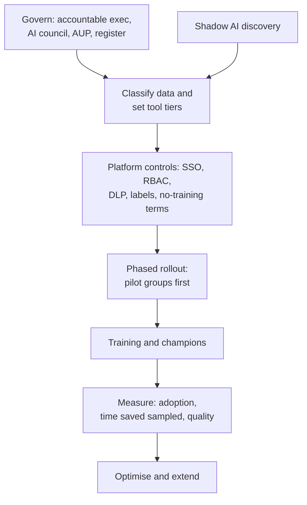

**Deployment.** The vendor's enterprise tenancy; check the region and residency terms per vendor
(see reference table; Anthropic direct is US or global as at Oct 2026 **[secondary]**). Permission
exposure through the assistant's access to document stores is the main data risk.

**Typical risk tier.** 1-2 for general productivity; individual use cases built on top are tiered
separately (Gartner, 26 May 2026: uniform governance across agents leads to failure; govern by
tier).

**Build components.** Research B1 seven-step pattern: govern first lightly, inventory and classify
(including shadow AI and APP 1.7 ADM mapping), use-case intake and prioritisation, platform
controls, phased rollout (Microsoft adoption phases), change management and literacy (board
included, which APRA flags), measurement. GitHub's adoption playbook (CC BY 4.0) adds the tiered
tool policy (vetted tools for confidential data; unvetted tools for public data only), advocates
network, communities of practice and a dedicated program owner. Detail sits with the planned
`ai-enterprise-rollout` skill.

**Effort drivers.** Staff numbers and sites; permission hygiene in document stores; DLP maturity;
union or consultation steps; number of business units; training depth.

**Client questions.** Will it expose documents people should not see? (It inherits existing
permissions, so permission hygiene comes first.) How do we know it is worth the licences?
(Adoption and sampled time-saved measures, not self-report only; research B1 step 7.)

## P11. Scoring or ranking people (decision support)

**When it fits.** Shortlisting candidates, triaging applications or claims, prioritising
leads or cases about individuals, eligibility pre-checks. Always tier 3 when the output shapes a
decision that significantly affects the person (conventions s6); the APP 1.7 ADM check applies
(`ai-compliance-risk/references/adm-check.md`), and in hiring the anti-discrimination rules in the
recruitment pack apply.

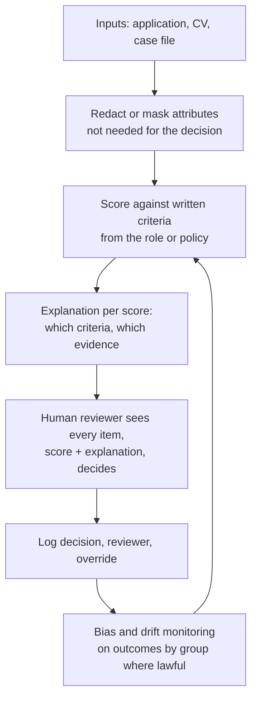

**Design rules.** Decision support, not decision: no automated reject or cut-off unless every item
is still reviewed by a person (a cut-off nobody reads makes those decisions solely automated).
Criteria written down and agreed with the client before build. Explanations shown to the
reviewer. Overrides logged and reviewed. Bias testing before go-live and on a schedule
(`governance-compliance` lines). Disclosure to the people scored per the ADM check, including
when the client's existing vendor tool (ATS, CRM) already scores people.

**Deployment.** As P1/P5; personal data residency per the reference table. Vendor tools that rank
people need vendor due diligence (`ai-compliance-risk` mode g).

**Effort drivers.** Criteria agreement, data quality of inputs, redaction rules, bias test design,
reviewer UI, logging, integration with the system of record (ATS, case system).

**Common client questions.** Is it legal to use AI to screen? (Identify obligations, refer to the
legal adviser.) Do we have to tell candidates or customers? (ADM check.) Can it reject people
automatically? (Not in our designs without per-item human review.)
