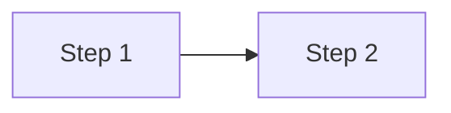

# AI discovery notes: {Client} -- {YYYY-MM-DD}

*File as `{client}/meetings/{YYYY-MM-DD}-{who}-ai-discovery-notes.md`. Internal working record.
Numbers exactly as the client said them, with who said it. `PENDING` where unknown.*

| Field | Value |
|---|---|
| Session type | First call / workshop / stakeholder interview |
| Attendees (name, role, organisation) | |
| Size band | S / M / L / XL |
| Industry (pack used) | |
| Decision-maker and signer | |
| Internal owner (named) | |
| Engagement channel | The practice direct / Telco ICT referred |
| Recording | Yes (consent given) / No |

## 1. The problem in their words
> Quote.

Why now:
What happens if nothing changes for a year:

## 2. Success measure
| Measure | Baseline today (client figure, who said it) | Target the client named | How it will be measured |
|---|---|---|---|
| | | | |

## 3. Candidate processes
Repeat per candidate.

### Candidate {n}: {name}
| Field | Value | Said by |
|---|---|---|
| Steps today (or Mermaid below) | | |
| Who does it (role) | | |
| Volume (per day/week/month) | | |
| Time per item | | |
| Loaded hourly cost | PENDING unless client gave it | |
| Error rate and cost of an error | | |
| Systems touched | | |
| Exceptions and how often | | |
| Turnaround expectation | | |
| What the AI must never do alone | | |
| Samples promised (what, by when) | | |

## 4. Data
| Question | Answer |
|---|---|
| Where it lives | |
| Consistency and quality | |
| Personal / sensitive information | |
| Who may see what | |
| Residency or contract constraints | |
| Already in public AI tools? | |

## 5. Systems and access
| System | Version / plan | API or export | Admin (internal / MSP / vendor) | Sandbox available |
|---|---|---|---|---|
| | | | | |

## 6. People and change
Owner, users, champions, concerns, approvals needed, history of past rollouts.

## 7. Risk and compliance flags (for the `ai-compliance-risk` screen)
| Flag | Answer |
|---|---|
| Decisions about people (APP 1.7 limbs) | |
| Sector regulator | |
| EU exposure | |
| Customer-facing | |
| Recording | |
| Existing AI policy / register | |
| Worst plausible harm | |
| Provisional risk tier (1-4) | |

## 8. Technical constraints
Cloud preference, SSO, security requirements, residency, banned tools, expected volumes.

## 9. Commercial
| Item | Answer |
|---|---|
| Budget range (client's words) | |
| Timing and any hard date | |
| How they will judge success at 3 months | |
| Preferred commercial shape | |
| Who pays run costs | |

## 10. Follow-up list
| # | Question / missing number | Why it matters | Who can answer | Due |
|---|---|---|---|---|
| 1 | | | | |

## 11. Our read (internal)
Fit, risks, proposed next step, routing (readiness assessment / compliance screen / design).
