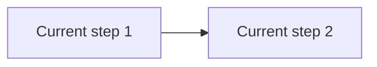
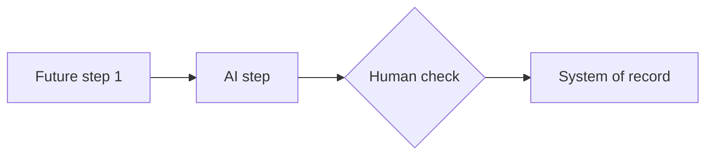
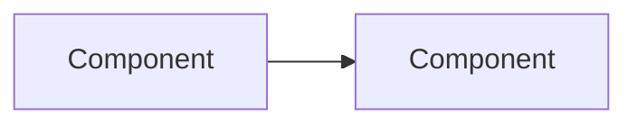

# Solution design brief: {use case} -- {Client} -- {YYYY-MM-DD}

*File as `{client}/created/docs/strategy/solution-design-brief-{use-case}-{YYYY-MM-DD}.md`. If any
part goes to the client, it passes a client-facing tone review first. Detailed architecture and ADR
come from the `ai-architect` agent.*

## 1. Problem
In the client's words (quote), with the numbers from discovery and their source line.

| Measure | Today | Source |
|---|---|---|
| Volume | | |
| Time per item | | |
| Error rate / cost | | |
| Success measure and target | | |

## 2. Current process

Pain points marked.

## 3. Future process

What changes for each role. Human-in-the-loop tier chosen (human does with AI suggesting / AI
does with human approving each action / AI does with human sampling / autonomous within hard
limits) and why.

## 4. Solution pattern and architecture
Primary pattern (P1-P11 from `solution-patterns.md`), any secondary pattern.

## 5. Data flow and trust boundaries
| Data item | Classification | Source | Where processed (service, region) | Where stored | Retention | Who can access |
|---|---|---|---|---|---|---|
| | | | | | | |

## 6. Platform choice
| Option considered | Residency | Fit | Decision |
|---|---|---|---|
| | | | |
Residency claims re-verified against vendor docs on: {date} (conventions s3).

## 7. Risk tier and controls
Provisional tier: {1-4}. Confirmed by `ai-compliance-risk` on: {date or PENDING}.
APP 1.7 ADM applies: yes / no / to confirm.
Controls planned (per conventions s6 minimums): access control, logging, eval baseline, privacy
check, human review design, approval for irreversible actions, kill switch, spend cap.

## 8. Evaluation plan
What "working" means, the golden set (source and size), acceptance threshold agreed with the
owner, how it is monitored after go-live.

## 9. Assumptions
| # | Assumption | If wrong |
|---|---|---|
| 1 | | |

## 10. Out of scope
Explicit list.

## 11. Open questions and PENDING items
| # | Item | Owner | Due |
|---|---|---|---|
