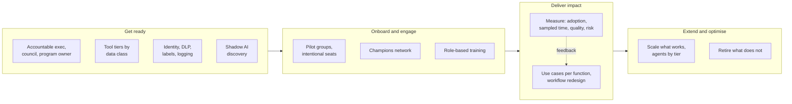

<!-- Changelog: 2026-11-08 (v0.1.0) -- Phase 2 build per ai-automation blueprint. -->

Read `../_shared/engagement-conventions.md` first.

# AI Enterprise Rollout (L and XL)

Large organisations rarely fail at AI because of the model. They fail at adoption, workflow
integration and control: licences bought and unused, staff on unapproved tools anyway, nobody
able to say what changed. This skill runs the rollout as a change program with controls built
in. Size band L (200-499) and XL (500+); for M clients use the lighter steps flagged below.

Two evidence points shape the method (research B1, use with their caveats):

- **Workflow redesign, not tool deployment.** McKinsey's State of AI: "AI high performers" (at
  least 5% of EBIT attributable to AI) are about 6% of respondents; nearly three-quarters of them
  fundamentally redesigned workflows versus about one-quarter of others, and workflow redesign has
  the biggest effect on EBIT impact.
- **Govern by risk tier.** Gartner (26 May 2026): applying uniform governance across AI agents
  will lead to enterprise agent failure. Light-touch approval for low-risk productivity use; full
  impact assessment only for high-risk.

## Department relationships

- **Invoked by** `ai-manager` for any L/XL engagement that goes beyond one or two use cases, or
  when the client asks to roll out an enterprise assistant (pattern P10 in
  `ai-discovery-scoping/references/solution-patterns.md`).
- **Depends on** `ai-governance-program` for the policy and AUP, governance charter and AI
  council, AI register and shadow AI method, literacy plan (including board) and incident
  playbook. This skill sequences and operationalises them across the organisation; it does not
  rewrite them.
- **Uses** `ai-compliance-risk` for per-use-case screens (agents and use cases are tiered one by
  one), `ai-use-case-portfolio` for intake, ranking and benefits tracking, `ai-readiness-assessment`
  for the starting position, and the `ai-architect` agent (method: `ai-solution-architecture`) for
  identity, DLP and platform design.
- **Hands to** `ai-rag-engineering` (another agent is writing it) for permission-aware company
  knowledge, `ai-deployment-platforms` (same) for tenancy and residency detail,
  `ai-agents-automation` for process automations, `ai-evals-security-testing` and
  `ai-optimisation-llmops` for testing and the run loop, `ai-proposal-pricing`
  for the program quote (`change-training` and `governance-compliance` buckets carry most of it).

## The rollout in one view

Phase names are Microsoft's Copilot adoption phases (research B1 step 5); the method applies to
any vendor's enterprise assistant. Phases overlap; the gates below do not.

## Phase gates

| Phase | Exit gate |
|---|---|
| Get ready | Accountable executive and program owner named; AUP published with tool tiers; sanctioned tool(s) live with SSO, no-training terms confirmed in contract, logging on; permission hygiene check done on document stores the assistant can reach; shadow AI baseline recorded; ADM inventory started (10 Dec 2026 duty, register AU-8); consultation plan agreed with HR (and unions where applicable) |
| Onboard and engage | Pilot groups trained and using the tool; champions recruited in every pilot area; adoption baseline (active and engaged users) recorded; support channel live |
| Deliver impact | At least one redesigned workflow per pilot function with a measured baseline and a first planned-vs-actual result (`ai-use-case-portfolio`); risk incidents reviewed |
| Extend and optimise | Scale decisions taken on evidence; agents admitted only through the tiered screen; quarterly review cadence running; board report delivered |

## Method (detail in references)

1. **Program structure** (`references/rollout-phases.md` s1). Accountable executive, program
   owner (GitHub's playbook calls this the DRI: an enabler, not a gatekeeper), AI council from
   `ai-governance-program`, champions network, RACI (`templates/raci.md`).
2. **Sanctioned tool tiers by data class** (s2). Map the client's data classes to tool tiers.
   GitHub's two-tier model (fully vetted tools for confidential data; unvetted public tools for
   public data only) is the starting point; L/XL clients usually need a third tier for sensitive
   or regulated data on an onshore or private platform.
3. **Identity and platform controls** (s3). SSO on every sanctioned AI tool; RBAC by role; SCIM
   or equivalent provisioning so leavers lose access automatically; enterprise tenancy with
   no-training terms; DLP and sensitivity labels applied before the assistant can reach the
   document stores; prompt and output logging within privacy limits. Vendor feature claims are
   verified per vendor at design time.
4. **Shadow AI replacement** (s4). Discovery first (`ai-governance-program/references/shadow-ai-discovery.md`),
   then a sanctioned alternative for every common use found, a transition date, and only then
   blocking. Discovery, not discipline.
5. **Champions, training and communications** (`references/people-and-change.md`). Champions
   by self-nomination; role-based learning paths with the board track from the governance
   literacy plan; a communications plan that tells staff honestly how roles will change.
6. **Consultation and WHS** (people-and-change s4). Union and employee consultation, the NSW
   Work Health and Safety Amendment (Digital Work Systems) Act 2026 (register AU-21: passed,
   duties not yet commenced), workplace surveillance considerations. Identify for the client's
   HR and legal advisers; never advise.
7. **Workflow redesign per function.** For each pilot function, take the top use cases from the
   portfolio and redesign the workflow end to end (who does what, what is removed, where AI
   sits, where the human decides) rather than handing out licences and hoping. Process mapping
   method: `ai-agents-automation/references/process-selection.md`.
8. **Govern agents by risk tier.** Productivity use of the assistant: AUP plus register entry.
   Each agent or automation: its own screen and tier, its own control spec
   (`ai-agents-automation`), tier 3 gets the impact assessment. No blanket approval or blanket ban.
9. **Measure** (`references/measurement.md`, `templates/adoption-scorecard.md`). Usage, sampled
   time saved, quality, risk incidents, cost, business KPIs per use case. No invented
   productivity multipliers.
10. **Plan** (`templates/rollout-plan.md`): 90-day plan and 12-month plan.

## Size bands

| Band | Shape |
|---|---|
| M (borrow selectively) | Two-tier tool policy, SSO, one pilot group, a handful of champions, all-staff session; skip SCIM and labels if the suite does not support them easily |
| L | Full four phases; council; champions per department; DLP where the suite supports it; quarterly board update |
| XL | All of L plus per-business-unit waves, data classification program, labels before assistant access, LMS-delivered training, champions community of practice, union consultation plan, ISO 42001 readiness alignment via `ai-governance-program` |

## Output conventions

- Rollout plan, RACI and comms plan in the client's `created/docs/strategy/`
  (`ai-rollout-plan-{YYYY-MM-DD}.md`, `ai-rollout-raci-{YYYY-MM-DD}.md`); scorecards in
  `reports/adhoc-report/` (`ai-adoption-scorecard-{YYYY-MM}.md`).
- Scorecards carry more than 3 numbers: R2 verifier in `scripts/verifiers/`.
- Anything touching employment law, consultation or surveillance carries the conventions
  disclaimer: "This assessment identifies regulatory considerations for review by your legal
  adviser. It is not legal advice."
- Client-facing text passes a client-facing tone review. Log the action to your own engagement activity log.

## Do not

- Do not buy or assign licences ahead of a defined use case and a trained user (Microsoft's
  playbook stresses intentional seat assignment).
- Do not block shadow AI before a sanctioned alternative exists.
- Do not let an assistant reach document stores before permission hygiene is checked: it
  inherits existing permissions, including the wrong ones.
- Do not report self-reported time savings as measured benefit, or apply a vendor's productivity
  figure to the client.
- Do not tell a client how consultation or WHS law applies to them; identify it for their adviser.

## Known gaps (v0.1.0)

- Union consultation and enterprise agreement obligations have no register row
  (PENDING_VERIFICATION); Fair Work and state surveillance Acts are named overlays only.
- AWS CAF for AI and Google adoption framework versions PENDING_VERIFICATION (research).
- McKinsey 2026 report figures PENDING_VERIFICATION; only the earlier State of AI figures are used.
- Vendor-specific DLP, label and SCIM capabilities are not catalogued; verify per vendor.

Provenance: `references/vendored-provenance.md` (GitHub's AI adoption playbook, CC BY 4.0,
attribution required).

*Source note (2026-11-08): the McKinsey State of AI figures used above come from the practice research
file and carry no edition and URL. Before any of them goes in a board-facing document, re-read them
from the McKinsey report itself and record the edition and link, or drop them. They are
`PENDING_VERIFICATION` as citations, not as direction.*
