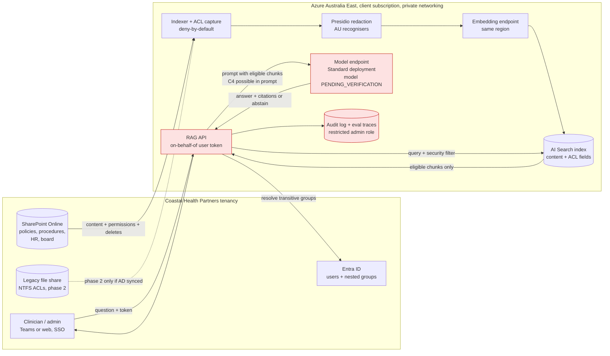

# PROVISIONAL solution design outline: staff knowledge assistant -- Coastal Health Partners (FICTIONAL DRY RUN)

*Call-prep only. Built with ai-solution-architecture, ai-rag-engineering, ai-deployment-platforms. No model name, price or regional availability is asserted: every such item is PENDING_VERIFICATION until checked live on the vendor page.*

## 1. Requirement restatement

About 520 staff (clinicians and admin) across 14 Queensland clinics ask questions in plain English over about 6,000 policies, procedures and de-identified clinical guidelines held in SharePoint Online and a legacy file share. HR and board documents are restricted. Answers must cite their source and abstain when the corpus has no answer. All processing and storage must stay in Australia. Success measure: time to find a correct answer, baseline PENDING (discovery). Risk tier 2 PROVISIONAL, size band XL.

Load-bearing unknowns: share of scanned documents; how file share ACLs are structured and whether on-prem AD is synced to Entra ID; whether the "de-identified" guidelines were de-identified to a standard (re-identification risk); the ten real questions users ask; Copilot licensing and AU processing terms.

## 2. Ladder and buy-vs-build

| Rung | Verdict |
|---|---|
| 1 SaaS/config: Microsoft 365 Copilot over SharePoint (client is on M365 E3) | **Not ruled out; test first in discovery.** Cannot conclude from the skills: Copilot licence cost per seat, its AU processing commitment and whether it reaches the legacy file share are PENDING_VERIFICATION (not covered by the department's research or platform tables). |
| 2 No-code workflow | Fails: the query path needs retrieval and permission filtering, not a fixed flow |
| 3 Prompt plus tools | Fails: 6,000 documents cannot be carried in a prompt |
| 4 Permission-aware RAG | **Recommended build route if rung 1 fails** on any of: legacy file share must be covered; licence cost out of proportion for 520 seats; controlled corpus with custom citations needed; residency terms do not meet the data class |
| 5-6 | Not justified (no eval evidence that RAG falls short; fine-tuning does not add fresh facts) |

Three-year TCO comparison (Copilot vs Azure RAG vs Bedrock RAG): every unit price PENDING_VERIFICATION, so the total is PROVISIONAL and not shown. The discovery line "buy-first comparison" runs the same golden subset against Copilot so the decision rests on the client's own eval, not a vendor claim.

## 3. Data classes and platform

| Flow | Highest class | Reason |
|---|---|---|
| Corpus: policies, procedures | C1 Internal | |
| Corpus: HR and board | C2 Confidential, C3 if staff records present | Restricted audiences |
| Corpus: de-identified clinical guidelines | C2, treat as C3 until de-identification standard confirmed | Re-identification risk |
| Prompts | C4 possible | Clinicians may type patient details despite policy; design fails closed |
| Logs, traces, caches | Same as prompts (C4) | |

Shortlist (max three, client's existing clouds first):

| Criterion | A. Azure Standard deployment, Australia East + Azure AI Search | B. AWS Bedrock `au.*` profile + own ACL connector | C. Microsoft 365 Copilot |
|---|---|---|---|
| Residency | Meets if every component (model, embeddings, AI Search, logs, parser) is in Australia East; Standard deployment only, never Data Zone or Global | Meets if index, logs and embeddings sit in Sydney/Melbourne | PENDING_VERIFICATION |
| Permission-aware retrieval | **Native document-level security against Entra principals and Purview labels** (research B2; harvested Azure sample) | Bedrock KB ACL features PENDING_VERIFICATION: we write principal IDs into metadata and filter ourselves; sandbox proof required before a fixed quote | Inherits SharePoint permissions; file share coverage PENDING_VERIFICATION |
| Identity fit | Entra ID already the identity provider (M365) | Needs Entra federation into the AWS app | Native |
| Model availability | Model in Australia East Standard PENDING_VERIFICATION | Model on `au.*` PENDING_VERIFICATION | n/a |
| Ops burden | Moderate | Higher (custom ACL sync) | Lowest |
| Lock-in / exit | Azure Search features; keep data, prompts, evals portable | Same | Highest |

**Recommendation: A (Azure, Australia East, Standard deployment, Azure AI Search with Entra-based document-level security)**, because identity and the main document store already live in Microsoft and it is the only platform where the department has a verified document-level permission pattern. Strongest alternative: B, if the client wants Claude models or treats AWS as its strategic cloud, at the cost of a custom ACL connector proven in sandbox. Copilot (C) stays in play until the discovery comparison. CLOUD Act caveat applies to all three (US-headquartered providers; onshore is not sovereign). XL hybrid routing through a gateway is deferred until a second use case with a different data class needs it.

Note the friction: `ai-deployment-platforms` decision flow sends "mixed" clouds to Bedrock by default; this design departs from it on the retrieval evidence.

## 4. Permission-aware retrieval

- Access model C (document-level). Query runs with the signed-in user's resolved principals (on-behalf-of flow), filter inside the search query before ranking, never post-filtered.
- Early binding (index-time ACLs) for policies; **hybrid** (live re-check of cited documents) for HR and board content, per permission-aware-retrieval s2 guidance for HR.
- Deny-by-default: chunks without readable ACLs are not returnable; ingestion fails closed.
- Group expansion: store group IDs, resolve transitive groups at query time from the directory (not token claims). ADR.
- Legacy file share: NTFS ACLs need mapping to Entra object IDs; only possible if AD is synced. Otherwise out of scope or access model B (partitioned) for all-staff folders only. Excluded from the pilot.
- Revocation latency target per data class, agreed with the client (HR/board shorter). Separate permission-sync and group-sync schedules faster than content re-index.
- Leak paths closed: cache keyed by permission set or off for restricted content; per-user history; log access restricted; same filter on suggestions and citations.
- Audit per request: user, principal hash, eligible and cited chunk IDs, filter flag, index version.
- PII: Presidio with AU recognisers on ingestion of guidelines and as an output scanner; prompt-side warning plus detection for patient identifiers.

## 5. Data flow with trust boundaries

Personal-data paths (red): prompts may carry patient details; the model endpoint, API and logs therefore sit inside the Australian boundary with restricted log access. No component leaves Australia East; nothing crosses to a vendor-direct API.

## 6. ADRs to write (one each)

ADR-001 rung (Copilot vs custom RAG, after discovery eval). ADR-002 platform (Azure A, alternative B). ADR-003 binding (early, hybrid for HR/board). ADR-004 group expansion (query time). ADR-005 file share treatment. ADR-006 UI channel (Teams vs web).

## 7. Effort drivers (to ai-proposal-pricing; no hours here)

`rag-knowledge`: number of SharePoint sites, broken inheritance and sharing links, nested groups, scanned share, file share ACL mapping. `governance-compliance`: over-sharing review, golden set size, permission-leak suite roles, red-team depth. `custom-agent-app`: Teams vs intranet. `change-training`: 14 clinics, shift workers, staff concern. `run-ongoing`: re-index and ACL sync monitoring, model retirements in Australia East.
