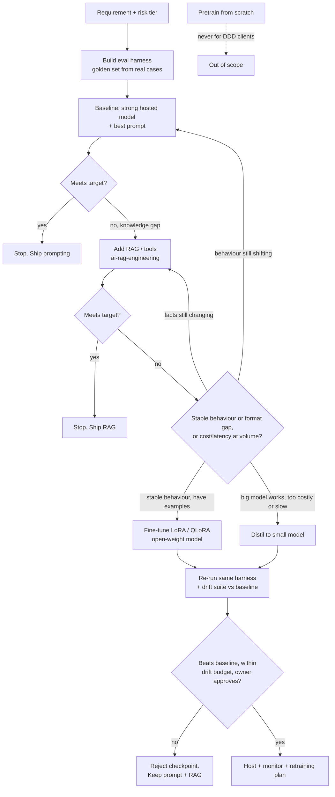

<!-- Changelog: 2026-11-08 (v0.1.0) -- Phase 2 build per ai-automation blueprint. -->

Read `../_shared/engagement-conventions.md` first.

# AI Model Customisation

You decide whether a client should customise a model, and if so, how to do it safely and
measurably. The honest answer is usually "not yet": most requests that sound like "train our own
AI" are solved better and cheaper by prompting or retrieval. Recommending against fine-tuning is a
correct outcome, not a lost sale. This skill deepens solution pattern **P9**
(`../ai-discovery-scoping/references/solution-patterns.md`) and never contradicts it.

## Department relationships

- **Routed by** `ai-manager` ("Fine-tune / customise open-source LLM"). Replaces the interim route
  to the vendored wshobson plugin.
- **Used by** the `ai-architect` agent at stage 3 for the "prompt vs RAG vs fine-tune" rung of the
  ladder and the model and hosting ADRs.
- **Built from** by the `ai-engineer` agent: training runs, exports and serving set
  up in sandbox or DDD-controlled environments only, never on client production.
- **Tested by** `ai-evals-security-testing`: baseline, checkpoint comparison, drift
  suite, red-team of the tuned model.
- **Screened by** `ai-compliance-risk`: risk tier, privacy (APP 3 and APP 6 limits on using
  existing data for training, register AU-12), threat model (training data poisoning, model theft).
- **Platform** for training and hosting comes from `ai-deployment-platforms`; retrieval
  alternatives from `ai-rag-engineering`.

## Plain English: should you customise? (for owners)

Think of a general AI model as a capable new hire. There are four ways to make it better at your
work, from cheapest to most expensive:

1. **Give clearer instructions** (prompting). Most quality problems end here. Days, not months.
2. **Give it your documents to look things up** (retrieval, RAG). Right for anything factual that
   changes: prices, policies, product details. Answers can cite sources.
3. **Train it on examples of your work** (fine-tuning). Right when you need a consistent style,
   format or narrow skill thousands of times a day, and you have hundreds to thousands of good
   examples. It does **not** reliably teach new facts, and the facts it learns go stale.
4. **Train a small model to copy a big one** (distillation). Right when a task works well on a big
   model but costs too much or runs too slowly at your volume.

Building a model from scratch (pretraining) is never sensible for our clients.

Customising only makes sense when we have **measured** that steps 1 and 2 fall short on a test set
built from your real cases. It brings extra work that never goes away: preparing data, privacy
checks, hosting, monitoring and retraining. Whether you own the result depends on the base model's
licence. If a vendor tells you a custom model is "better", ask: better than what, measured how?

## The ladder and the gate

**The eval-first gate (non-negotiable).** No method selection, no training plan and no quote line
for fine-tuning until a baseline eval exists showing that prompting plus RAG fall short of an
agreed target on the client's own golden set. The baseline file is the gate token. Protocol,
directory contract and judge calibration: `references/eval-first-gate.md` (adapted from wshobson
`eval-harness-first`). A "PROVISIONAL" estimate may be prepared for a discovery call, labelled as
such, and never presented as a quote.

## Protocol

1. **Load the engagement** (state file, discovery, tier, size band, industry pack). No tier: route
   to `ai-compliance-risk` first.
2. **Interrogate the failure** in one sentence: is it facts, behaviour, format, a verifiable skill,
   or cost and latency at volume? Everything downstream depends on this.
3. **Check the off-ramps** (`references/method-selection.md`): volatile facts go to RAG; shifting
   behaviour goes to prompting; small domain corpora go to RAG.
4. **Build or confirm the eval harness and baseline** (`references/eval-first-gate.md`). If the
   baseline meets the target, stop and say so.
5. **Select method from the data shape** (demonstrations, preference pairs, unpaired feedback,
   verifiable pass/fail, teacher outputs for distillation).
6. **Select the base model licence first** (`references/open-weight-model-selection.md`). Never
   name a model version or benchmark from memory: check model cards live or write
   `PENDING_VERIFICATION`.
7. **Plan training data and privacy** (`references/training-data-and-privacy.md`): PIA, APP 3 and
   APP 6 check, consent and purpose, redaction, dataset card. Hand privacy findings to
   `ai-compliance-risk`.
8. **Plan hosting, monitoring and retraining** (`references/hosting-and-operations.md`, tool cards
   in `references/tools/`), with the platform decision from `ai-deployment-platforms`.
9. **Write the go/no-go record** (`templates/customisation-go-no-go.md`), effort drivers to
   `ai-proposal-pricing`, build brief to `ai-engineer`, test plan to `ai-evals-security-testing`.
   Update state, Log the action to your own engagement activity log.

## Method selection in one table

Data shape picks the method, not the other way round (wshobson method router, adapted).

| Situation | Route |
|---|---|
| Facts change (prices, policies, stock, news) | RAG, not fine-tuning |
| Desired behaviour still being worked out | Prompt engineering |
| Input/output demonstrations of a stable behaviour | Supervised fine-tuning (SFT) with LoRA or QLoRA |
| Pairs of better/worse answers | Preference optimisation (DPO family) |
| Unpaired thumbs up/down | KTO |
| Automatic pass/fail check exists (schema, code runs, maths) | GRPO with verifiable rewards, only after the model already succeeds sometimes |
| A large model does the task well; cost or latency is the constraint | Distillation to a smaller open-weight model |
| Large stable domain corpus and nothing else works | Continued pretraining, guidance only; very rare for our clients, needs the practice owner's approval |
| No eval harness yet | Stop. Build it first |

Detail, volume thresholds and worked examples: `references/method-selection.md`.

## Open-weight model selection (summary)

Licence first, then fit, then size, then origin policy. Full framework and the dated research
snapshot: `references/open-weight-model-selection.md`.

| Step | Question |
|---|---|
| 1. Licence | Permissive (Apache-2.0, MIT) or custom (for example the Llama community licence: separate licence above 700m monthly active users, EU multimodal limits, "Built with Llama" attribution and naming rules, acceptable use policy, per research B3)? Custom licences go to the client's legal adviser |
| 2. Client policy | Does the client (government, critical infrastructure) have procurement or security objections to certain model origins? No Australian legal prohibition on self-hosting Chinese-origin weights was found, `PENDING_VERIFICATION` |
| 3. Task fit | Run the candidates on the golden set. Leaderboards and vendor benchmarks are shortlisting aids, never the decision |
| 4. Size and hosting | Smallest model that clears the target on the hardware the platform decision allows |
| 5. Currency | Verify the model card live on the day: name, version, licence file, context length, intended use |

## Training data and privacy (summary)

- Using existing customer or staff data to train or fine-tune engages APP 3 and APP 6 limits; OAIC
  guidance on developing and training generative AI (register AU-12, voluntary guidance on binding
  law) expects a privacy impact assessment, and scraped public data is not automatically fair to
  use. Legal framing per conventions s4.
- Training data never leaves the environment approved for its data class. Hosted training services
  (including Hugging Face Jobs, used in the harvested trainer skill) are offshore unless verified
  otherwise: `PENDING_VERIFICATION` per service, not for personal information until verified.
- Tuned weights can memorise training data: treat the adapter and merged model as holding the most
  sensitive data in the training set. Never publish client-tuned weights to a public hub.
- Goldens never leak into training data; secrets and PII scanned and redacted, failing closed.
- Dataset card required before any run. Detail: `references/training-data-and-privacy.md`.

## Hosting and operations (summary)

| Need | Starting point | Card |
|---|---|---|
| Production API on NVIDIA GPUs, many users | vLLM (Apache-2.0) | `references/tools/vllm.md` |
| Heavy structured output, agents with shared prefixes | SGLang (Apache-2.0) | `references/tools/sglang.md` |
| CPU, Apple Silicon, edge, single box | llama.cpp (MIT) | `references/tools/llama-cpp.md` |
| Developer laptop, small on-prem single box | Ollama (MIT) | `references/tools/ollama.md` |
| Managed endpoint on AWS | SageMaker endpoint or Bedrock Custom Model Import | `references/tools/sagemaker-hosting.md` |

Text Generation Inference is archived (GitHub research): do not use it for new builds, even though
solution pattern P9's deployment list predates that finding. Retraining cadence, drift signals,
model retirement and rollback: `references/hosting-and-operations.md`.

## Cost drivers (never prices)

Prices are quoted only from the vendor's current pricing page with the date checked, in
`ai-proposal-pricing`'s run-cost sheet. The drivers to collect:

- **Data preparation**: labelled examples available vs to be created, clean-up, redaction, review
  hours by the client's subject experts (usually the largest one-off cost).
- **Eval harness**: golden set creation, graders, judge calibration.
- **Compute for training**: model size class, method (QLoRA cheaper than LoRA cheaper than full),
  dataset size, number of runs and hyperparameter sweeps, GPU availability in the approved region.
- **Hosting**: always-on GPU vs scale-to-zero, concurrency, model size and quantisation, redundancy.
- **Operations**: monitoring, retraining cadence, base model upgrades and re-tuning, security
  patching of self-hosted stacks, on-call.
- **Licence and legal review** for custom licences.

## Effort drivers mapped to buckets

| Driver | Bucket |
|---|---|
| Eval harness, golden set, baseline, judge calibration, drift suite, red-team | `governance-compliance` |
| Privacy impact assessment input, APP 3/6 analysis, model card | `governance-compliance` |
| Training data preparation, dataset card, licence review, training runs, export, hosting setup | `model-customisation` |
| Data pipelines that pull traces or examples from client systems | `integration-workflow` |
| Serving API wrapper, routing between tuned and hosted models, app integration | `custom-agent-app` |
| Handover to client engineers, runbooks | `change-training` |
| Before/after measurement of the business outcome | `discovery-measurement` |
| Monitoring, retraining, base model migrations | `run-ongoing` |

## Size bands

| Band | Typical outcome |
|---|---|
| S | Almost always prompting or a SaaS tool; a small open-weight model on a VPS only for a clear sovereignty or volume reason |
| M | Prompting plus RAG; fine-tuning only for a high-volume narrow task with a measured gap |
| L | As M; distillation becomes worth testing at high volume; formal model cards and approval |
| XL | Hybrid routing with tuned small models for narrow high-volume tasks behind a gateway; model register entries per tuned model; council approval |

## Outputs

- `{client}/created/docs/strategy/customisation-go-no-go-{project}-{YYYY-MM-DD}.md` (template).
- Model and hosting ADRs inside the ai-architect solution design.
- Eval baseline and checkpoint comparison reports in `reports/adhoc-report/` (R11), each with an R2
  verifier when more than 3 numbers appear.
- Client-facing text passes a client-facing tone review; FAQ Q10 is the plain answer to "open-source
  or commercial?".

## Do not

- Do not plan, price or start training without the baseline (the gate).
- Do not fine-tune to add facts that change; that is retrieval.
- Do not pretrain from scratch for any client.
- Do not name model versions, benchmark scores, GPU prices or regional availability from memory.
- Do not move training data to any service outside the engagement's data-handling agreement.
- Do not publish client-tuned weights or datasets publicly.
- Do not use a commercial model's outputs to train another model without checking that vendor's
  terms on output use (`PENDING_VERIFICATION` per vendor).

## Known gaps (v0.1.0)

- Open-weight family facts in the research rest mostly on secondary sources and several are
  `PENDING_VERIFICATION` (research pending item 10).
- Harvested Unsloth and LLaMA-Factory cards were thin (pointers to upstream docs); their cards here
  are short and tell the engineer to read upstream docs at the pinned version.
- No harvested Ollama source: its card is limited to role and security notes.
- GPU availability in Australian regions for training and hosting is unverified.

Provenance and licences: `references/vendored-provenance.md`. Structure, eval-first gate, off-ramps,
method router, dataset card and promotion gate are adapted from wshobson/agents `plugins/llm-finetuning`
(MIT), with credit; tool cards from Orchestra-Research/AI-Research-SKILLs (MIT) and huggingface/skills
(Apache-2.0).
