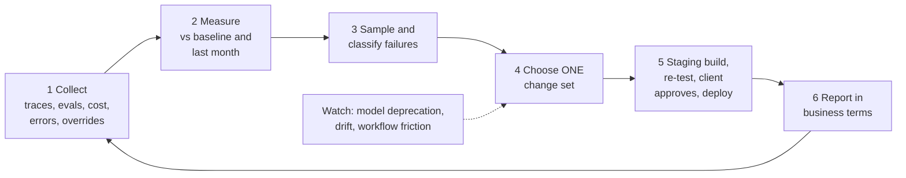

<!-- Changelog: 2026-11-08 (v0.1.0) -- Phase 3 build per ai-automation blueprint. -->

Read `../_shared/engagement-conventions.md` first.

# AI Optimisation and LLMOps (the monthly improvement loop)

This is stage 8 (Run) of the engagement lifecycle and the engine of DDD's run-and-improve
retainer. Its reason to exist is a research finding: MIT NANDA's 2025 study attributes the lack of
measurable return from most GenAI pilots to learning, saying most systems "do not retain
feedback, adapt to context, or improve over time" (web research headline 7; a pilot-to-P&L
finding from 153 surveys, 52 interviews and 300+ public cases, not "95% of AI projects fail").
The GitHub research found tools for each step but no skill that runs the monthly loop as a
managed service (gap 6). This skill is that loop, for AI **and** the workflow around it.

## Department relationships

| Who | Relationship |
|---|---|
| `ai-manager` | Routes "optimise", "costs up", "quality dropped", "monthly review" here; receives the report summary; tracks the retainer in the engagement state |
| `ai-optimiser` agent | **Runs this skill** (read-only on traces and data). Its Method and Output sections are the contract |
| `ai-engineer` agent | Implements the approved change set in staging |
| `ai-security-tester` agent / `ai-evals-security-testing` | Re-runs the golden set and the relevant red-team families on every change set; `../ai-evals-security-testing/scripts/eval_compare.py` gives the verdict; a regression blocks |
| `ai-compliance-officer` / `ai-compliance-risk` | Material changes (new model or vendor, new data, more autonomy, new user group) go back for a tier re-check and, if needed, a sign-off refresh |
| `ai-proposal-pricing` | **All retainer pricing lives there** (run-ongoing bucket, prices end in 100/300/600/700/800 via its estimator). This skill defines the scope fences only |
| `ai-rag-engineering`, `ai-agents-automation` | Own the designs this loop tunes (retrieval settings, agent controls, human-in-the-loop tier) |

## Hard rules

1. **Read-only on client systems.** Data comes from exports, trace stores and logs the client
   granted. **Never hit a client's live website or system to generate data** (memory
   `do-not-hit-client-websites-from-monitors`).
2. **One change set per cycle**, ranked by impact and risk, so next month can attribute the
   effect. Emergency fixes (a leak, a runaway cost) skip the queue but still go through staging
   and re-test.
3. **Nothing reaches production without** staging build (ai-engineer), re-test with no
   unaccepted regression (ai-security-tester), and the client's written approval.
4. **No invented numbers.** No token prices, savings rates, productivity multipliers or
   benchmarks from memory. Costs come from the usage data's own `cost_aud`; hours saved come from
   the client's own baseline minutes per task; vendor pricing statements only as quoted in
   `references/cost-levers.md` with source and date, otherwise "check the vendor's pricing page
   live".
5. **Separate real change from noise** before calling anything a trend (`references/monthly-loop.md` s2).
   A tracking problem is never reported as performance.
6. **Every report with more than 3 numbers has an R2 verifier** in the client's `scripts/verifiers/`.

## Triage mode (a live system is wrong NOW)

The loop below is monthly. Clients ring on a Tuesday. When something live is giving wrong answers,
leaking, over-spending or has stopped, run triage first and the loop later.

1. **Contain before diagnosing.** Decide with the client whether to pause the system, switch it to
   human-only handling, or let it run. For anything customer-facing, agentic or tier 3, the default
   is pause. Use the kill switch from the agent control spec. Record the decision and the time.
2. **Scope the harm.** What was wrong, since when, how many interactions, who saw it, whether
   personal data or money moved, whether a decision about a person was affected. If personal data
   was exposed, the data-breach path is the client's own obligation under the Privacy Act and the
   NDB scheme: say so immediately and hand it to `ai-compliance-risk`, which routes it to the
   client's privacy officer and legal adviser. Do not wait for the diagnosis.
3. **Reproduce.** Get the exact input. Re-run it against the current configuration, then against
   the last known good configuration. If it only fails in production, suspect data, permissions or
   version drift rather than the prompt.
4. **Diagnose in this order**, cheapest first: a change on our side (prompt, config, index,
   deployment) -> a change on the vendor's side (model version, deprecation, region, rate limits)
   -> a change in the client's data or permissions -> genuine model behaviour on a new input shape.
   Check `references/drift-and-model-migration.md` before concluding it is the model.
5. **Fix in staging, not production.** `ai-engineer` implements, `ai-security-tester` re-runs the
   affected eval categories plus the always-blocking ones, the client's owner approves, then it
   ships. An emergency change still gets an eval run; a prompt edit straight into production is how
   the next failure is caused.
6. **Write it up the same day**: what happened, scope of harm, cause, fix, what stops it recurring,
   and a new golden-set item that would have caught it. Add the incident to the client's AI register
   (`../ai-governance-program/templates/incident-response-playbook.md` owns the full incident path
   for anything with a privacy, safety or legal dimension).

Triage is not in the fenced retainer unless the retainer says so. If it is out of scope, say that
and quote it (`../ai-proposal-pricing`), rather than absorbing it silently.

## The loop (mirrors `ai-optimiser` Method 1 to 5, plus implement and report)



Detail for every step: `references/monthly-loop.md`.

1. **Collect** the period's traces (model, prompt version, inputs and outputs masked, retrieval
   hits, tool calls, latency, tokens), eval runs, cost and usage export, error and dead-letter
   queues, escalations, and user feedback and overrides (thumbs plus reason, edits to drafts,
   rejected suggestions). Tooling: `references/observability-stack.md` (Langfuse MIT core default
   self-hosted; Opik Apache-2.0 alternative; Phoenix ELv2, client self-host only, never resold by
   DDD; platform-native logs).
2. **Measure** against baseline and last month: quality (eval pass rates, faithfulness,
   escalation and override rates), cost per task (and per user, total), latency, volume, failure
   rate. Cost trend: `scripts/cost_trend.py` (below). Quality: `../ai-evals-security-testing/scripts/eval_compare.py`.
3. **Sample and classify failures**: at least the worst 20, or all if fewer, each tagged with
   one cause: retrieval, prompt, model, data, tool, workflow, user.
4. **Choose one change set** ranked by expected impact and risk, from: prompt change (DSPy or
   GEPA, both MIT, when a metric and held-out set exist), retrieval tuning, model routing (cheaper
   model for easy cases), prompt caching and batch processing (`references/cost-levers.md`),
   workflow step removal or merge (`references/workflow-optimisation.md`), golden-set growth
   (every classified failure worth keeping becomes a test). Write `templates/change-set.md` with
   the expected effect and how it will be measured next month.
5. **Implement and verify**: ai-engineer builds in staging; ai-security-tester re-runs the
   suite; the client approves in writing; deploy with the rollback noted; pin the new versions.
6. **Report** with `templates/monthly-optimisation-report.md`: headline in business terms
   (hours saved against the client's own baseline, cost per task, quality trend), what changed
   and why, the proposed change set, risks, and what will be measured. R2 verifier.

## Standing watches (every cycle)

| Watch | What to do | Detail |
|---|---|---|
| Model deprecation and version migration | List every pinned model per system; check the vendor's deprecation or retirement page live; record dates; plan migration as a change set well before retirement | `references/drift-and-model-migration.md` s3 |
| Drift | Input mix, output quality sample, feedback, retrieval hit rate, cost and latency per task, safety incidents, source-content freshness | `references/drift-and-model-migration.md` s1-s2 |
| Workflow friction | Manual steps, double approvals, handoff delays and rework around the AI | `references/workflow-optimisation.md` |
| Compliance triggers | New data class, new user group, more autonomy, new vendor or region: back to `ai-compliance-risk` | conventions s2, s6 |

## Cost trend script

```bash
python3 scripts/cost_trend.py usage.csv [--system NAME] [--flag-threshold 0.20] [--md out.md] [--json out.json]
```

Reads `date, system, model, tasks, input_tokens, output_tokens, cached_input_tokens, cost_aud`
and prints, per system and month: tasks, cost, cost per task, input and output tokens per task,
token mix, cache share, model cost mix, month-on-month change, and flags. **It never prices
tokens**: it only aggregates the `cost_aud` supplied in the data. The default flag (cost per task
up more than 20% month on month) is a **DDD default, not an industry figure**; set it per client
with `--flag-threshold`. Volume swings and model changes are flagged as context so a rise is not
misread. Worked sample: `scripts/samples/`.

## Outputs and locations

| Output | Location (client folder) |
|---|---|
| Monthly report | `reports/adhoc-report/ai-optimisation-{YYYY-MM}.md` (or the client's agreed location), rendered with `tools/report-renderer/render_report.py` for client-facing copies |
| Change set | `created/docs/strategy/ai-change-set-{system}-{YYYY-MM-DD}.md` |
| Retainer scope | `created/docs/strategy/ai-retainer-scope-{YYYY-MM-DD}.md` (fences only; price from ai-proposal-pricing) |
| Verifier | `scripts/verifiers/verify_ai-optimisation-{YYYY-MM}.py` |
| Usage exports, trace samples | client `data/` (masked), never `reports/` or `created/` |

Client-facing text passes a client-facing tone review (decision-focused: what happened, why it
matters, what next). Log the action to your own engagement activity log.

## Retainer (scope only)

`templates/retainer-scope.md`: fenced by number of systems, eval cycles per month, change sets
per month, support hours, and what counts as a new project. **Never "unlimited".** Pricing goes
to `ai-proposal-pricing` (run-ongoing bucket, its estimator); this skill never states a price.
Tokens and hosting are paid by the client directly where possible, otherwise passed through at
cost, stated.

## Size bands

| Band | How the loop scales |
|---|---|
| S | One or two automations; platform-native logs may be enough; quarterly cycle can suit if volume is low (agree with client) |
| M | Langfuse or Opik self-hosted; monthly cycle; report to the department head |
| L | Client IT runs the trace store; DDD reads exports; change sets go through client change control |
| XL | Per-system loops roll up to the AI council; drift and incidents feed the AI register and board reporting |

## Do not

- Do not deploy, or let a change skip staging, re-test or client approval.
- Do not stack several changes in one cycle and then credit one of them.
- Do not present platform-attributed or model-reported metrics as business results without
  saying what they measure.
- Do not offer Phoenix as a DDD-managed service (ELv2); do not harvest its code.
- Do not quote a token price, discount or saving that is not in `references/cost-levers.md`
  with its source and date.

## Known gaps (v0.1.0)

- Langfuse, Opik and Phoenix were not harvested; entries rest on the GitHub research (licences,
  activity). Feature details are `PENDING_VERIFICATION` at deployment.
- Phoenix licence: GitHub research (API) says Elastic Licence 2.0; the harvested Orchestra how-to
  says Apache 2.0 and MIT in different places. DDD treats it as ELv2 until the live LICENSE file
  is checked.
- Pricing statements cover Anthropic's direct API only (research B6). Bedrock, Azure and Vertex
  pricing for the same levers is `PENDING_VERIFICATION`.

Provenance and licences: `references/vendored-provenance.md`.
