<!-- Changelog: 2026-11-08 (v0.1.0) -- Phase 2 build per ai-automation blueprint. -->

Read `../_shared/engagement-conventions.md` first.

# AI RAG Engineering (company knowledge retrieval)

You design and specify retrieval-augmented generation (RAG) systems over a client's own
documents, and you make sure nobody can retrieve a document they are not allowed to open. This
skill deepens solution pattern **P2** (`../ai-discovery-scoping/references/solution-patterns.md`)
and never contradicts it. The single most important rule in this skill:

> **Retrieval is filtered by the querying user's identity at query time, never by the
> application's service identity.** Missing permission data means the document is not returned.

## Department relationships

- **Routed by** `ai-manager` (routing table: "Company RAG, permission-aware retrieval").
- **Used by** the `ai-architect` agent at stage 3 (Design) for the RAG section of the solution
  design, the access-control design and the ADRs.
- **Built from** by the `ai-engineer` agent, in sandbox or staging only, never on
  client production. This skill is its specification.
- **Tested by** `ai-evals-security-testing`: the golden set, faithfulness and
  recall evals, and the permission-leak suite in `templates/permission-leak-test-plan.md`.
- **Screened by** `ai-compliance-risk`: risk tier, APP obligations, threat model (OWASP LLM02:2026
  Sensitive Information Disclosure, LLM09:2026 Vector and Embedding Weaknesses, LLM01:2026 prompt injection
  through retrieved content). No build before a tier exists (conventions s2).
- **Platform and residency detail** comes from `ai-deployment-platforms`. **Large rollouts**
  (XL, SSO/RBAC programme, change management) pair with `ai-enterprise-rollout`.
- **Pricing**: effort drivers below go to `ai-proposal-pricing` in the bucket slugs it accepts.

## Ground truth (R1)

Client documents and systems first, then `../_shared/regulatory-register.md`, then live vendor
docs, then the research files (the department's original research files (internal, not included in this repo)
section B2, `ai-dept-github-research-2026-11-08.md` area 3). Never name an embedding model, a
vector store tier, a price or a regional availability from memory. Feature claims for **Bedrock
Knowledge Bases ACLs and Vertex AI Search ACLs are `PENDING_VERIFICATION`** (research B2 and
pending item 9): verify in the vendor docs before a design relies on them.

## Protocol

1. **Load the engagement.** State file, discovery notes, risk tier, size band, industry pack.
   No tier yet: stop and route to `ai-compliance-risk` (a PROVISIONAL design may be prepared for
   a call, labelled as such).
2. **Pin the six RAG facts** (one bundled question for whatever is missing):
   sources and their systems; approximate document counts and formats (how much is scanned);
   who may see what (is every document visible to every user?); identity provider (Entra ID,
   Google, Okta, other) and whether groups are nested; residency requirement per data class;
   the questions users actually ask (ten real examples).
3. **Run the buy-first check** (below). Record the result even when it says "build".
4. **Choose the access model** (below): open corpus, coarse partitions, or document-level
   permission-aware retrieval. M and above with mixed permissions always gets document-level.
5. **Design the pipeline** with `templates/rag-design-checklist.md`: ingestion and connectors,
   parsing and OCR, PII redaction, chunking and metadata, embeddings and store, retrieval and
   reranking, generation with citations, logging. Detail in `references/`.
6. **Design the evals before the build**: golden question set, retrieval and faithfulness
   targets, and the permission-leak plan. Targets agreed with the client's owner.
7. **Hand over**: design section to `ai-architect`, effort drivers to `ai-proposal-pricing`,
   threats to `ai-compliance-risk`, test plan to `ai-evals-security-testing`, build spec to
   `ai-engineer`. Update state, Log the action to your own engagement activity log.

## Buy-first check (always before a custom build)

Climb the ladder cheapest first (ai-architect method step 2). Each rung above the first needs a
one-line reason the lower rung fails.

| Client situation | Test first | Custom RAG justified when |
|---|---|---|
| Microsoft 365 with documents in SharePoint/OneDrive | Microsoft 365 Copilot over SharePoint, which inherits existing SharePoint permissions (P10) | Sources outside M365 matter; licence cost per seat is out of proportion for the users who need it; answers need a controlled corpus, custom citations or workflow actions; residency terms do not meet the data class |
| Google Workspace with documents in Drive | Google's Workspace assistant or enterprise search product (current product names, AU processing and ACL behaviour `PENDING_VERIFICATION`; research did not cover them) | Same reasons as above |
| Knowledge lives inside one SaaS (helpdesk, wiki, CRM) | That vendor's built-in AI search, after vendor due diligence (`ai-compliance-risk` mode g) | Cross-system answers needed; vendor fails the residency or training-on-data gate |
| Small corpus, every user may see everything (often S band) | A SaaS knowledge assistant or a simple managed stack | Residency, citation or integration needs the SaaS cannot meet |

**The permission hygiene warning applies to the buy route too.** An assistant that inherits
permissions exposes every over-shared folder instantly. Whatever the route, run an
over-sharing review of "Everyone" and organisation-wide links on the in-scope sites before
go-live (P10 client question: "It inherits existing permissions, so permission hygiene comes
first").

## Access models

| Model | When it is acceptable | Mechanism |
|---|---|---|
| A. Open corpus | Every user may see every document (public or all-staff content), confirmed in writing by the client owner | One index, no ACL filter; still SSO and logging |
| B. Partitioned | A few clean, stable audiences (for example board pack vs all-staff) with no per-document exceptions | Separate indexes or collections per audience, chosen from the user's group at query time |
| C. Document-level, permission-aware | Any M+ client with mixed permissions, HR, legal, finance, client files, or nested groups | Permission metadata (user and group IDs, labels) stored on every chunk; filter applied inside the search query by the querying user's identity; deny-by-default |

S-band clients may use A or B only when the corpus genuinely fits (P2 deployment note). If the
client cannot say who may see what, that is a discovery gap, not a reason to choose A.

Model C design detail, including early vs late binding, ACL sync, revocation latency, group
expansion, the Azure AI Search pattern and the Onyx approach as a reference only, is in
`references/permission-aware-retrieval.md`. Minimum rules:

- **User identity, not app identity.** The query carries the signed-in user's token or resolved
  principal set; the app's service identity is used only to read the index, never to decide
  what the user may see.
- **Filter before ranking**, inside the search engine query (security trimming), never by
  post-filtering a top-k list in application code (post-filtering leaks through counts,
  snippets, re-ranking and "no result" differences, and returns too few results).
- **Deny-by-default.** A chunk with no permission metadata is not returnable. "Everyone"
  access is an explicit value set at ingestion from the source system, never inferred from an
  empty field.
- **Group expansion handled.** Nested groups resolved either at ingestion (store expanded
  principals) or at query time (expand the user's transitive groups); the choice is an ADR.
- **Revocation latency is a target** agreed with the client (how long until a removed permission
  stops showing up in answers) and tested.
- **Every answer is auditable**: who asked, which chunks were eligible, which were cited.

## Pipeline at a glance

```mermaid
flowchart LR
  subgraph Sources
    SP[SharePoint / OneDrive] 
    GD[Google Drive]
    CF[Confluence]
    FS[File shares]
  end
  Sources --> C[Connector: content + ACLs + deletes]
  C --> X[Parse / OCR / tables]
  X --> R[PII redaction<br/>Presidio + AU recognisers]
  R --> K[Chunk + metadata<br/>source, page, owner, labels, ACL]
  K --> E[Embed]
  E --> IDX[(Hybrid index<br/>vector + keyword + ACL fields<br/>same AU region as model)]
  U[User via SSO] --> Q[Query service<br/>user token / principals]
  Q --> F{Security filter<br/>in the search query}
  IDX --> F
  F --> RR[Rerank top results]
  RR --> G[LLM answer with citations<br/>or abstains]
  G --> U
  G --> L[(Audit log + eval traces)]
  C -. ACL changes + deletions .-> IDX
```

| Stage | Decision you must record | Reference |
|---|---|---|
| Connectors | Native connector vs export vs API; sync frequency; delete handling; ACL capture | `references/ingestion-and-connectors.md` |
| Parsing and OCR | Layout-aware parser for tables and scans; cost vs quality per format | same |
| PII redaction | What is redacted, masked or kept; where redaction runs; audit | `references/pii-redaction-presidio.md` |
| Chunking and metadata | Chunk size and overlap, structure-aware splits, metadata schema | `references/ingestion-and-connectors.md` |
| Embeddings and store | Embedding model, dimensions, store, region, re-embedding plan | `references/retrieval-and-evaluation.md` |
| Retrieval | Hybrid (keyword + vector), filters, reranker, top-k, query rewriting | same |
| Generation | Citation format, abstain behaviour, prompt-injection handling of retrieved text | same |
| Evaluation | Golden set, metrics, targets, permission-leak suite | same + `templates/permission-leak-test-plan.md` |

## Residency rule

The vector store, the keyword index, logs, eval traces and any cache sit in the **same
Australian region as the model** or the residency claim does not hold (research B2;
solution-patterns residency rule). Embedding generation is a model call too: the embedding
endpoint's region counts. Platform choice per data class comes from
`ai-deployment-platforms/references/data-class-matrix.md`.

## Size bands

| Band | Typical design |
|---|---|
| S | Buy-first usually wins. If custom: access model A or B, one or two sources, managed store in an AU region, 30-50 question golden set, light logging |
| M | Access model C when permissions are mixed. SSO, group sync, deny-by-default, revocation target agreed (often hours, client decides), golden set of 100+ real questions, permission-leak suite |
| L | As M plus procurement and vendor due diligence for the store and connectors, client IT owns the identity side, threat model reviewed by client security, staged rollout by department |
| XL | As L plus data classification and sensitivity labels feeding the filter, DLP alignment, tenancy separation between business units, formal revocation SLA, audit reporting to the AI council, permission-leak tests in every release pipeline; pair with `ai-enterprise-rollout` |

## Evaluation (designed before build, run by ai-evals-security-testing)

- **Golden Q&A set** built from real user questions and checked by a subject-matter owner. The
  Azure sample generates synthetic ground truth and then has a human remove unrealistic pairs;
  we use synthetic only to top up real questions, never instead of them.
- **Retrieval recall** (did the right source appear in the top results), **faithfulness /
  groundedness** (is every claim supported by the cited chunks), **citation match**, **answer
  relevance**, **abstain correctness** (says "I don't know" when the corpus has no answer).
- **Permission-leak suite**: user A must never retrieve, be shown a snippet of, or be answered
  from user B's restricted document, including through rephrasing, prompt injection, nested
  groups, revoked access, deleted documents and missing ACLs. Any leak is a Critical finding
  and blocks go-live. Full plan: `templates/permission-leak-test-plan.md`.
- Pass marks are agreed with the client's owner and recorded; re-run on every change to
  prompts, model, chunking, embeddings or connector code (research B6).

## Effort drivers mapped to buckets

Use only these slugs (`../ai-discovery-scoping/references/delivery-buckets.md`).

| Driver | Bucket | What makes it bigger |
|---|---|---|
| Buy-route setup (Copilot tenancy settings, Workspace assistant, SaaS knowledge tool) | `config-saas` | Number of sites or tenants, policy settings, client IT turnaround |
| Connectors, sync jobs, delete handling | `rag-knowledge` | Number of sources, no API, old on-prem versions, throttling limits |
| ACL capture, group expansion, revocation design and monitoring | `rag-knowledge` | Nested groups, per-item sharing links, broken inheritance, external guests, multiple identity providers |
| Parsing, OCR, table handling | `rag-knowledge` | Scanned volume, handwriting, poor scans, table-heavy documents |
| Document clean-up and de-duplication pipeline | `integration-workflow` | Versions and copies, stale content, no owner per folder |
| Permission hygiene and over-sharing review | `governance-compliance` | Sites with "Everyone" links, no site owners, unclear data classification |
| Eval baseline, golden set, permission-leak suite, threat model | `governance-compliance` | Tier, number of user roles to test, regulated content |
| PII redaction rules and tests | `governance-compliance` | Number of entity types, sensitive information (health, TFN), review cycles |
| Custom chat UI, citation viewer, feedback capture | `custom-agent-app` | UI requirements, embedding in existing intranet or Teams |
| User training, admin handover, runbooks | `change-training` | User groups, sites, low digital confidence |
| Baseline measurement of time-to-answer before build | `discovery-measurement` | Number of teams measured |
| Re-indexing, ACL sync monitoring, eval loop, model and embedding migrations | `run-ongoing` | Corpus growth, sync frequency, model retirements |

Platform, embedding and store running costs are not hours: they go to the run-cost sheet in
`ai-proposal-pricing` with a vendor source URL and date checked.

## Outputs

- RAG section of `{client}/created/docs/strategy/ai-solution-design-{YYYY-MM-DD}.md` (via
  ai-architect), or a standalone `rag-design-{project}-{YYYY-MM-DD}.md` from the checklist.
- `permission-leak-test-plan-{project}-{YYYY-MM-DD}.md` in `created/docs/security/`.
- Client-facing text passes a client-facing tone review. Answers to "can staff only see their
  documents?" use `../_shared/client-faq.md` Q11. More than 3 numbers: R2 verifier.

## Do not

- Do not filter results with the application's own identity, or post-filter in app code.
- Do not treat an empty ACL as "everyone".
- Do not ingest a source whose permissions you cannot read unless every user may see all of it.
- Do not put client documents into a tool outside the engagement's data-handling agreement,
  including for embedding experiments or test runs.
- Do not copy code from Onyx's enterprise-licensed `ee/` folder (or any other `ee/`); describe
  approaches only (`../_shared/VENDORED.md` do-not-harvest list).
- Do not quote accuracy figures from vendors or demos; quote the client's own eval result.
- Do not name an embedding model or store tier from memory; verify live or `PENDING_VERIFICATION`.

## Known gaps (v0.1.0)

- Bedrock Knowledge Bases and Vertex AI Search ACL support not verified (research pending 9).
- Google Workspace assistant products, their ACL behaviour and AU processing not researched.
- No first-party DDD code yet: the Azure sample is the only harvested end-to-end reference, so
  non-Azure document-level designs rely on the generic metadata-filter pattern (llama_index,
  haystack per GitHub research) and need a sandbox proof before a quote is fixed.

Provenance and licences: `references/vendored-provenance.md`.
