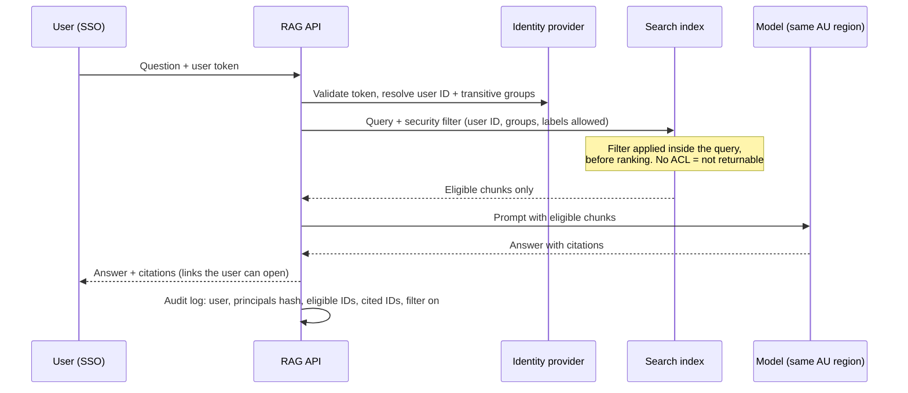

# Permission-aware retrieval (access model C)

*v0.1.0, 2026-11-08. Sources: research B2 (`ai-dept-web-research-2026-11-08.md`), GitHub research
area 3 and gap 4, harvested `ai-kb/vendor/Azure-Samples__azure-search-openai-demo/docs/login_and_acl.md` (MIT,
SHA in `vendored-provenance.md`). Source-system behaviours listed below are interrogation prompts
for discovery: confirm each against the client's system and the vendor's current documentation
before the design relies on it.*

## 1. The principle

Retrieval is filtered by the **querying user's identity at query time**, never by the
application's service identity. Permission metadata (user IDs, group IDs, sensitivity labels) is
indexed alongside every chunk, and the filter is applied **before ranking**, inside the search
engine query (research B2). Everything below is how to make that true in practice and how to
prove it.



## 2. Where the permission data comes from: early vs late binding

Security trimming always happens at query time. The design choice is whether the permissions it
trims against are a **snapshot taken at ingestion** (early binding) or **checked live against the
source system** (late binding). Record the choice as an ADR.

| Approach | How it works | Strengths | Weaknesses | Use when |
|---|---|---|---|---|
| Early binding (index-time ACLs) | Connector reads ACLs with the content, stores principals on every chunk; query filters on them | Fast; scales; works offline from the source; standard pattern (Azure AI Search permission filter fields, metadata filters in llama_index or haystack) | Revocation latency equals the sync interval plus indexing lag; ACL translation bugs are silent | Default for M and L |
| Late binding (query-time check) | Retrieve candidates, then ask the source system (for example a Graph or Drive permissions API) whether this user can open each one | Always current; no ACL translation | Slow; rate limits; source outages break search; post-filtering risks too few results and side channels unless done before anything is shown | Small, highly sensitive corpora; or as a second check |
| Hybrid | Early binding to filter, then a live re-check on the final cited documents | Near-current for what is actually shown; bounded API calls | More moving parts | XL, legal privilege, HR investigations, health records |

Never late-bind by showing results first and checking afterwards. Whatever is checked live must be
checked before a snippet, title, count or answer reaches the user.

## 3. ACL capture from source systems (discovery prompts)

Each source has its own permission model. Ask these before quoting; each "yes" is an effort driver.

| Source | Ask the client / inspect |
|---|---|
| SharePoint / OneDrive (M365) | Are permissions inherited from sites, or broken at folder and file level? How common are sharing links (anyone, organisation-wide, specific people)? Are Microsoft 365 groups, SharePoint groups and security groups all used? Are external guests present? Are sensitivity labels applied (research: Azure AI Search can enforce Purview labels)? |
| Google Drive | Shared drives vs My Drive? Link sharing (anyone with the link, whole domain)? Inherited folder permissions and exceptions? Google groups nested? |
| Confluence | Space permissions plus page-level view restrictions, and whether restrictions on a parent page restrict its children? Anonymous or all-licensed-user spaces? |
| File shares (Windows / NAS) | NTFS-style ACLs with directory groups? Explicit deny entries? Inheritance disabled on subfolders? Local accounts vs directory accounts? |
| Other SaaS (helpdesk, CRM, wiki) | Does the API expose per-record permissions at all? If not, the source is access model A or B only, or excluded |

**Inheritance is the classic silent bug.** The Azure sample's own documentation warns that its
ADLS Gen2 extractor reads ACLs set directly on each file and does not consider directory-level
inheritance, so ACLs must be set explicitly on each file. Every connector we build or buy gets a
test for inherited, broken-inheritance and explicit-deny cases (permission-leak plan cases P5-P7).

**Translate to principal IDs, not names.** Store stable directory object IDs, never display names
or email addresses (renames and reused addresses then cannot grant access).

## 4. Group expansion

| Option | How | Trade-off |
|---|---|---|
| Expand at query time | Resolve the user's transitive group memberships from the identity provider on each request (cached briefly) and filter on user ID plus all group IDs | Index stays small; group changes apply as fast as the cache allows; needs a fast directory call |
| Expand at ingestion | Store every user ID that can read the chunk | Simple filter; index updates on every membership change; large ACL fields |
| Mixed | Store group IDs on chunks, expand nested groups to their parent chain at query time | Usual choice |

Do not rely only on group claims inside the sign-in token: identity providers can omit or truncate
groups for users in many groups, and tokens live until they expire. Check the identity provider's
current behaviour (`PENDING_VERIFICATION` per provider) and resolve from the directory when in doubt.

## 5. Revocation latency

Revocation latency is how long a removed permission (or a deleted document, or a departed staff
member) keeps showing up in answers. It is a **design target agreed with the client owner and
tested** (P2, client FAQ Q11).

```
revocation latency  <=  ACL / delete sync interval
                      + indexing lag
                      + group-membership cache lifetime
                      + user token lifetime (if groups come from the token)
                      + any response or semantic cache lifetime
```

- Agree the target per data class (an HR or legal corpus may need a much shorter target than an
  all-staff policy library). Write it into the design and the permission-leak plan.
- Connector must handle **deletions and permission removals**, not only additions. Many sync jobs
  only pick up new or changed content.
- Offboarding: disabled accounts must fail at the identity step regardless of index state.
- Monitor sync lag in production (run-ongoing) and alert when it exceeds the target.

## 6. Deny-by-default

- A chunk with an empty or unparseable ACL field is **not returnable**.
- "Everyone" access is an explicit marker written at ingestion only when the source says so. The
  Azure sample is a worked example: its built-in access control requires the special `["all"]`
  value on each globally available document; older versions treated "no ACL" as global, and the
  sample documents a one-time migration away from that behaviour.
- Ingestion fails closed: if the connector cannot read a document's permissions, it skips the
  document and logs it, rather than indexing it without an ACL.
- Unauthenticated access is off for any corpus with restricted content.

## 7. Leak paths beyond the main index

Permission-aware search is undone by any shared layer that ignores identity. Check each:

| Layer | Risk | Control |
|---|---|---|
| Response or semantic cache | User B gets user A's cached answer | Key the cache by the user's permission set, or disable caching for restricted corpora |
| Conversation history and agent memory | Restricted content from one session surfaces in another | Per-user storage with the same access control |
| Logs and eval traces | Restricted text visible to anyone with log access | Log access limited to an approved admin role; redact where possible; same AU region |
| Embeddings themselves | Embedding vectors can leak information (OWASP LLM09:2026) | Treat the vector store as holding the source data; same access and residency controls |
| Query suggestions, autocomplete, "related documents" | Titles of restricted documents leak | Same filter applied to every retrieval call, not only the main one |
| Citations | Link to a document the user cannot open, or title of a restricted document | Citations only from filtered results |
| Admin or debug modes | Bypass headers or elevated roles left on | Azure's elevated-read debugging needs a specific data-contributor role: keep such roles off production app identities and audit their use |

## 8. Audit

Log per request: timestamp, user ID, hash of resolved principals, query text (or a redacted form),
filter applied (true/false, must always be true for restricted corpora), eligible chunk IDs, cited
chunk IDs, index version, ACL snapshot time. This answers "who could have seen this document, and
when" during an incident or a privacy complaint. Retention per the client's records policy.

## 9. Platform patterns

### Azure AI Search (harvested reference, MIT)

Research B2: document-level access via security filters (the Entra principal compared against
permission metadata), native ACL/RBAC scope ingestion for ADLS Gen2 and similar sources, and
Microsoft Purview sensitivity-label enforcement.

What the harvested sample shows, as design facts to carry into a build (re-check against the
current Microsoft Learn pages before building):

- Two Entra app registrations (client SPA and API server); the server uses the on-behalf-of flow
  and the Azure AI Search `user_impersonation` delegated permission so the query runs as the user.
- Index fields for user object IDs and group IDs; built-in enforcement sends the user's token on
  each query (the `x-ms-query-source-authorization` header). The older approach used explicit
  security-filter fields matched in the query.
- Recommended ingestion path: documents in ADLS Gen2 with hierarchical namespace and POSIX-style
  ACLs; an indexer plus functions extract ACLs (user and group IDs with read permission) into the
  index. Directory inheritance is not considered (see section 3).
- A verification script compares three searches: no user token, user token, and elevated read. We
  adopt the same three-way comparison in the permission-leak plan (case P1).
- Settings worth copying in spirit: authentication required, access control enforced, global
  access only by explicit marker, unauthenticated access off.

### AWS Bedrock Knowledge Bases, Google Vertex AI Search

Research B2: both support metadata filtering and connector-level ACL ingestion for some sources;
**specifics `PENDING_VERIFICATION`**. Until verified, design document-level access on these
platforms as: our own connector writes principal IDs into chunk metadata, the query service
resolves the user's principals and passes a metadata filter on every retrieval call, and the
permission-leak suite proves it in the sandbox before the quote is fixed.

### Open-source and self-hosted

Frameworks: llama_index (MIT) and haystack (Apache-2.0) expose metadata filters, the usual hook
for ACL filtering (GitHub research area 3). Front ends with SSO and SCIM: Open WebUI (verified
`scim.py`, OAuth and access-control utilities in tree, but a branding clause in its licence) and
LibreChat (MIT; enterprise auth options per its docs, `PENDING_VERIFICATION`). AnythingLLM (MIT)
showed no ACL or SSO files: SMB tier only. Small Apache-2.0 repos (ragguard, pansoph) push
document-level permissions into vector queries: "the right idea", too small to depend on.

### Onyx (reference only, enterprise-licensed, never copied)

GitHub research found the strongest document-level permission sync in Onyx's enterprise folder:
separate **document permission sync** and **group sync** jobs per connector (Google Drive,
Confluence, Jira, GitHub, Gmail, Box, HubSpot and others), so source ACLs and group memberships are
refreshed independently of content. That is the design idea we take: run permission sync and group
sync on their own schedules, faster than content re-indexing, because permissions change more often
than content and drive revocation latency. The code sits under the Onyx Enterprise Licence and is
on the department's do-not-harvest list. Describe the approach; do not copy, paraphrase line by
line, or vendor it.

## 10. Tenancy separation (L and XL)

Business units, subsidiaries or client matters that must never mix get separate indexes (or
separate collections with an enforced tenant filter) and, where the client requires, separate
encryption keys. A tenant filter is not a substitute for document ACLs inside a tenant.
