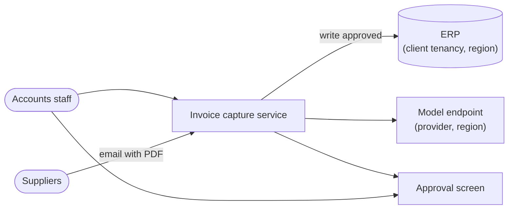
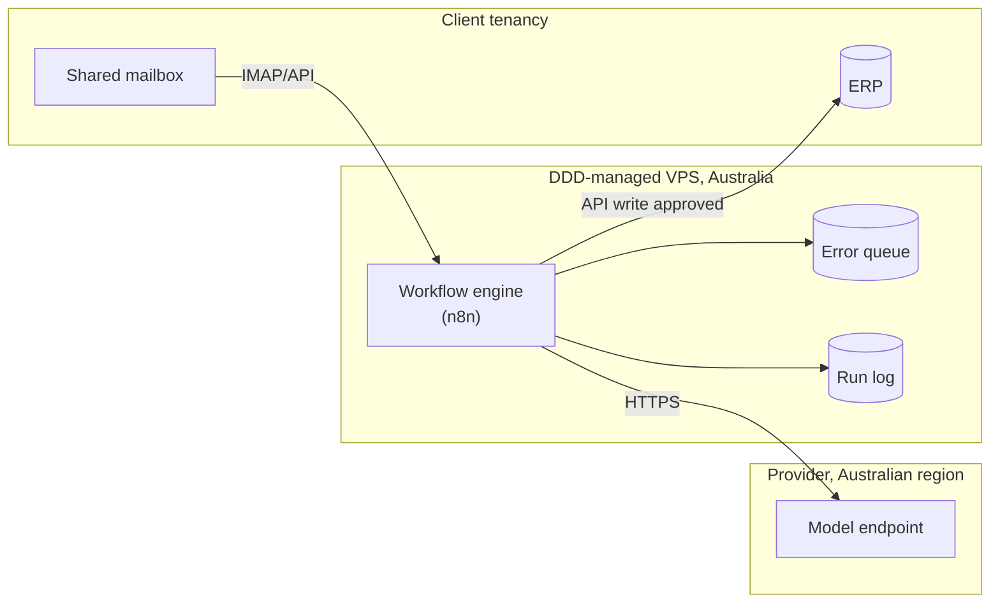
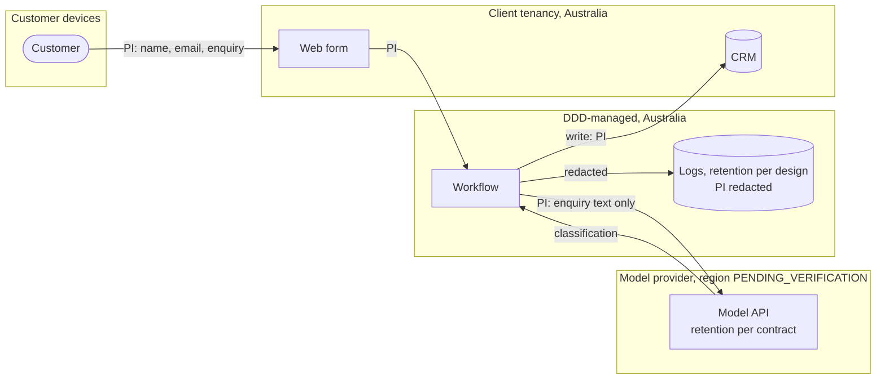
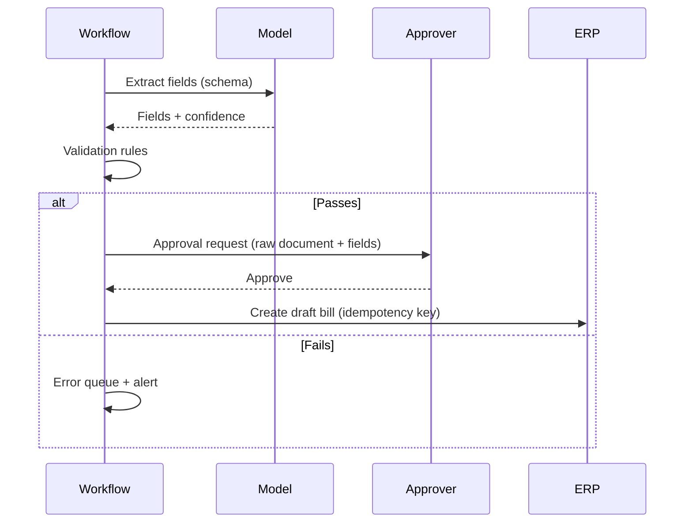

# Architecture views and Mermaid conventions

*v0.1.0, 2026-11-08. DDD conventions. The four views follow the common context, container,
data-flow and sequence split used in software architecture practice; nothing harvested is
copied. Mermaid renders in Markdown, Google Docs exports and the DDD report renderer
(conventions s7).*

## 1. Mermaid conventions

| Convention | Rule |
|---|---|
| Diagram type | `flowchart LR` for context, container and data flow; `sequenceDiagram` for interactions; `flowchart TD` for decision logic |
| Node labels | Plain words a client understands; technical names on a second line. Any label with punctuation goes in double quotes, and never nest brackets inside a shape: `M["Model endpoint (Bedrock, Sydney)"]` |
| Regions | Every external service and data store is labelled with its region or "region PENDING_VERIFICATION" |
| Shapes | `[(...)]` data stores; `[...]` services and steps; `{...}` decisions; `([...])` people or external actors |
| Trust boundaries | `subgraph` per boundary with an ID and a quoted title: `subgraph CT ["Client tenancy, Australia East"]` |
| Personal data | Edges carrying personal information labelled `PI:` plus the kinds (`PI: name, phone`); sensitive information `SI:` |
| Writes | Edges that write to a system of record labelled `write` and, if approval-gated, `write (approved)` |
| Size | One idea per diagram; split when a diagram passes about 15 nodes |
| No styling | No colours or classes: they do not survive every renderer and add nothing to meaning |

## 2. Context view

Who and what surrounds the system.

## 3. Container view

The deployable parts and how they communicate.

## 4. Data flow with trust boundaries and personal-data paths

The view the compliance officer and the client's privacy officer read. Show every boundary
crossing and every place personal data rests, including logs, caches, backups and the vendor's
own retention.

Checklist for this view:
- Every edge crossing a subgraph is a boundary crossing: what protects it (TLS, private link,
  allow-listed IP, signed webhook)?
- Every store holding PI: region, retention, who can read it, encryption.
- Minimisation: does each hop receive only the fields it needs?
- Untrusted input entry points marked (they feed the threat model: LLM01:2026, ASI01).

## 5. Sequence view

For the key interaction, and always for the approval path of anything that acts.

## 6. Which views a design needs

| Risk tier / size | Views required |
|---|---|
| Tier 1, S | Context + data flow (can be one diagram) |
| Tier 2 or M | Context, data flow, sequence for the main interaction |
| Tier 3 or L/XL | All four, plus a sequence for every approval path and the kill switch |
