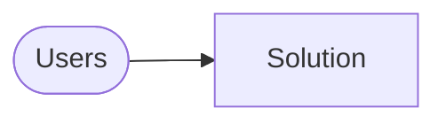
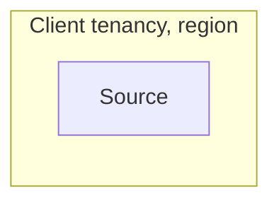
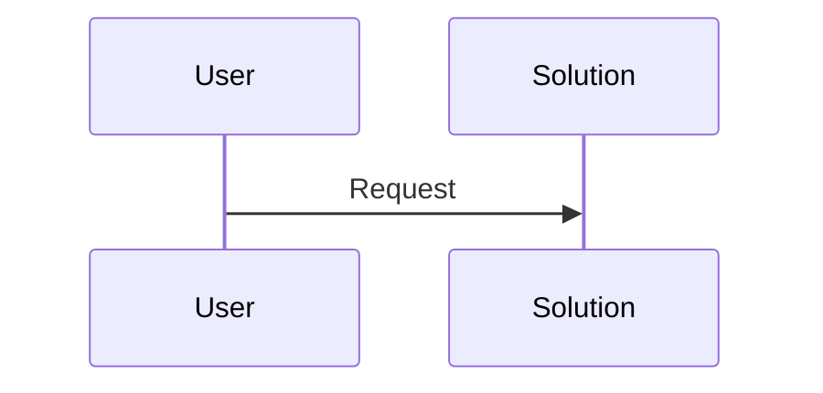

<!-- Audience: client (body) + client IT (appendices). Save as
{client}/created/docs/strategy/ai-solution-design-{YYYY-MM-DD}.md. Sections 1-12 follow the
ai-architect agent's output contract in order; do not drop one (write "not applicable" with a
reason). Passes client-voice before it goes to the client. R2 verifier if it carries more than 3
numbers. -->

# AI solution design: {use case}, {Client}

*Prepared by Design Data Dynamics, {date}. Version {n}. Engagement stage 3 (Design). Risk tier
{n} (screened {date}). Size band {S/M/L/XL}. This is a design, not a build.*

## 1. Summary and recommendation

{Four to six sentences: the problem in the client's words, what we recommend, why this option
(cheapest rung that meets the requirement), the strongest alternative in one line, the main risks,
and what the client needs to decide.}

## 2. Requirement restatement

| Item | Value | Source |
|---|---|---|
| Process | | Discovery notes {date} |
| Users (who, how many) | | |
| Volumes | | |
| Data classes involved | public / internal / confidential / personal / sensitive | |
| Systems | | |
| Success measure and baseline | | |
| Risk tier, ADM check result | | ai-compliance-risk {date} |
| Jurisdictions | | |

**Open questions** (load-bearing): {question, who answers, by when}.
**Assumptions** (that must stand): {assumption, risk if wrong}.

**Ladder position**: chosen rung {n}. Why lower rungs do not work: {one line per rung}.

## 3. Architecture diagram

Context view and container view (Mermaid, conventions in `references/architecture-views.md`).

## 4. Data-flow diagram

Trust boundaries and every personal-data path, including logs and backups.

Sequence view for the key interaction and every approval path (tier 2+):

## 5. Platform comparison and choice

| Factor | Option A | Option B | Option C |
|---|---|---|---|
| Residency (processing, storage, logs) | | | |
| Control | | | |
| Cost drivers (three-year TCO, see build vs buy) | | | |
| Operational burden | | | |
| Lock-in and exit path | | | |
| Time to value | | | |

**Choice**: {option}, because {reason}. Model and region verified at {vendor URL} on {date}.
Build vs buy worksheet: {link or appendix}.

## 6. Access control

Identity provider, SSO, roles, how permissions reach retrieval (querying user's identity), sync
and revocation latency, deny by default, audit logging. {"Not applicable: single internal user,
no personal data" if so.}

## 7. Agent controls

Summary of tools, permissions, approvals, limits, kill switch and logging. Full detail in the
agent control spec: {link}. {"Not applicable: no actions, read-only" if so.}

## 8. Integration list

| System | Entity | System of record? | Direction | Interface | Auth (Doppler key name) | Error handling |
|---|---|---|---|---|---|---|

## 9. Architecture decision records

{ADR-001 ... in the format of `templates/adr-template.md`, or links to separate ADR files.}

## 10. Effort drivers (for ai-proposal-pricing)

| Design element | Delivery bucket (slug) | What makes it bigger | Known now | Unknown |
|---|---|---|---|---|
| | config-saas / integration-workflow / rag-knowledge / custom-agent-app / model-customisation / governance-compliance / change-training / discovery-measurement / run-ongoing | | | |

Run-cost inputs (volumes, tokens per task, hosting components); unit prices are sourced by
ai-proposal-pricing, not here. No hours or prices in this document.

## 11. Risks and open questions

| Risk | Effect | Mitigation in the design | Goes to |
|---|---|---|---|
| | | | ai-compliance-officer / client / DDD |

## 12. Client-facing FAQ answers for this design

{Three to six questions this client will ask, answered plain English first, per
`references/customer-technical-questions.md`. Regulatory answers carry: "This assessment
identifies regulatory considerations for review by your legal adviser. It is not legal advice."}

---

## Appendix A: Non-functional requirements

{Completed `templates/nfr-checklist.md`.}

## Appendix B: Technical detail for IT

{Components, versions (pinned), regions, network paths, protocols, configuration, with sources.}

## Appendix C: Sources

| Claim | Source URL | Date checked |
|---|---|---|
