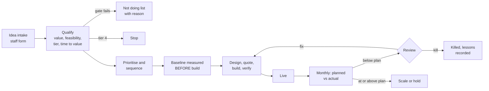

<!-- Changelog: 2026-11-08 (v0.1.0) -- Phase 2 build per ai-automation blueprint. -->

Read `../_shared/engagement-conventions.md` first.

# AI Use-Case Portfolio (organisation level)

Discovery finds and qualifies use cases for one engagement. This skill runs the **standing
portfolio** an organisation keeps after that: every idea in one place, ranked by the same rules,
measured before it is built, and measured again every month once it is live, until someone
decides to scale it or stop it. It is the gap the GitHub research flagged as unbuilt anywhere
public (gap 3: "AI use-case portfolio and ROI tracker").

The payoff language is the department's: hours removed, manual steps eliminated, systems
connected, risk controlled. A portfolio full of "AI ideas" with no hours attached is a wish list.

## Department relationships

- **Invoked by** `ai-manager` once an organisation has several candidates (usually after
  `ai-discovery-scoping`), or as a standing quarterly service for M, L and XL clients.
- **Reuses, does not redefine** `../ai-discovery-scoping/references/use-case-qualification.md`:
  the value rules, the feasibility 1-5 table (lowest sub-score wins), the three gate questions
  plus the tier gate, and the ranking order. If that file changes, this skill follows it.
- **Risk tier** comes from `ai-compliance-risk` mode (a). Until then the tier is provisional and
  marked so. Tier 4 stops; tier 3 needs the screen before design.
- **Links to** the AI register in `ai-governance-program` (`../ai-governance-program/templates/ai-register-template.md`):
  every live use case has an `ai_register_id`. The register says what exists and how risky it
  is; the portfolio says what it is worth and what happens next.
- **Hands to** `ai-architect` / `ai-solution-architecture` (design of the next approved item),
  `ai-proposal-pricing` (quote, value case from the same numbers), `ai-optimisation-llmops`
  (monthly loop for live systems), and `ai-enterprise-rollout` (L/XL intake runs
  through the rollout's use-case stage).

## The portfolio lifecycle



Statuses used by the register and the script: `idea`, `qualified`, `approved`, `build`, `live`,
`paused`, `killed`.

## Method

### 1. Intake (anyone can submit)

One form for the whole organisation (`references/intake-form.md`). It asks what a member of staff
can actually answer: the task, how often, how long, who does it, what goes wrong, what data it
touches. It does **not** ask staff to estimate savings in dollars. The portfolio owner turns the
answers into value inputs with the process owner.

For L/XL clients the form sits inside the rollout's use-case stage and the AI council reviews the
queue (research B1 step 3: single intake form; light-touch approval for low-risk productivity
uses, full impact assessment only for high-risk).

### 2. Qualify (reuse the discovery rules)

For each idea, fill the register row (`templates/portfolio-register-template.csv`):

- **Value**: annual AUD range from the client's own numbers, with `value_source` naming who said
  it and when (for example "Finance workshop 2026-07-02, finance manager"). Volume x time x loaded
  cost, computed only when all three are client-supplied (qualification s1). No source, no value.
- **Feasibility 1-5**: lowest of data, integration and complexity.
- **Risk tier 1-4**: provisional until screened.
- **Time to value (weeks)**: signed scope to first measurable result in production-like use.
- **Gates**: data there, named owner, can pilot in about 30 days, tier assigned and not 4.

Candidates that fail a gate go on the **not doing list** with the reason, so the idea is not
relitigated next quarter.

### 3. Prioritise and sequence

Run the script:

```bash
python3 scripts/portfolio.py portfolio.csv -o portfolio-review-{YYYY-MM-DD}.md
python3 scripts/portfolio.py portfolio.csv --strict   # exit 1 on any row error (use in CI or before a client review)
```

Ranking is the qualification order: value (sourced only, midpoint of the range), then time to
value, feasibility, risk tier. There is no composite score: a weighted total would hide which leg
is weak and invite argument about weights. Sequencing then adjusts the ranked list by hand for
three things the script cannot see, each written down as a reason:

1. **Dependencies**: an identity, data connection or eval set that a later item reuses goes first.
2. **Capacity**: no more items in build than the client's owners can test and adopt.
3. **Mix**: at least one boring back-office item with real hours before any customer-facing one
   (qualification s3 sanity check).

### 4. Baseline before build (non-negotiable)

No item moves to `approved` without a measured baseline of the current process: volume, time per
item, error or rework rate, cycle time, and the loaded cost the client supplied. Measured means
counted from system data or a timed sample (`references/benefits-tracking.md`), not a guess in a
meeting. The script flags `approved` or `build` rows with no baseline. Without a baseline, no
benefit can ever be claimed, and the client cannot tell a good automation from a bad one.

### 5. Benefits tracking after go-live (monthly)

Each month, for every live item: re-measure the same quantities the baseline used, record
`actual`, and compare realised benefit (baseline minus actual) with the planned range. Add the
run cost and the hours spent on exceptions and support, because those eat the benefit. Report in
business terms with the comparison period stated (communication-style decision-focused rules).
Template: `templates/benefits-review-template.md`.

### 6. Kill and scale decisions

| Signal (sustained, not one month) | Default recommendation | Who decides |
|---|---|---|
| Realised benefit below the planned low for two consecutive reviews, cause understood and fixable | Fix and re-measure, with a date | Process owner |
| Below plan, cause not fixable at reasonable cost | Kill; record lessons; keep reusable parts | Accountable owner |
| Within or above plan, adoption steady, exceptions stable | Scale (more volume, teams or document types) or hold | Accountable owner |
| Above plan by a wide margin | Check the measurement first; then scale | Portfolio owner |
| Risk incident or tier change | Pause; back to `ai-compliance-risk` | Accountable owner |

"Two consecutive reviews" is the practice's v0.1 default, not a sourced rule; agree the window with the
client at portfolio set-up. The practice recommends; the client's accountable owner decides and the
decision is recorded in the register.

## Script: `scripts/portfolio.py`

Stdlib only. Input columns: `id, name, owner, value_low, value_high, value_source, feasibility,
risk_tier, time_to_value_weeks, status, baseline, actual`, plus optional `compliance_screen`,
`ai_register_id`, `notes`. Units: value and baseline/actual are annual AUD; realised benefit is
baseline minus actual. It outputs a ranked markdown portfolio and flags: values with no
`value_source` (ignored for ranking), tier 4 (stop), tier 3 with no compliance screen, rows with
no owner or tier, approved/build rows with no baseline, live rows with no baseline, actual or
AI register link, and planned-vs-actual variance for live rows. Worked example (fictional
organisation): `scripts/samples/sample-portfolio-2026-11-08.csv` and its `.md` output.

## Size bands

| Band | Portfolio shape |
|---|---|
| S | A one-page list kept with the owner; quarterly review; script optional |
| M | Register sheet owned by an operations or finance lead; monthly review of live items |
| L | Register reviewed by the AI council; intake form open to all staff; benefits feed management reporting |
| XL | Intake through the rollout program; per-business-unit portfolios rolled up; benefits and risk incidents reported to the board with the AI register |

## Output conventions

- Files in the client's `created/docs/strategy/` (`ai-portfolio-register-{YYYY-MM-DD}.csv`) and
  reviews in `reports/adhoc-report/` (`ai-portfolio-review-{YYYY-MM-DD}.md`, rendered to HTML/PDF
  when client-facing).
- Every review has more than 3 numbers, so it gets an R2 verifier in `scripts/verifiers/` that
  recomputes realised benefit from the register CSV.
- Client-facing text passes a client-facing tone review. Lead with what to do next, then the table.
- Log the action to your own engagement activity log.

## Do not

- Do not put a dollar value in the register without a named source and date.
- Do not use vendor productivity claims, survey averages or percentage heuristics as value.
- Do not claim a benefit for an item with no baseline.
- Do not rank a tier 4 item, and do not design a tier 3 item before its compliance screen.
- Do not present platform-attributed or self-reported time savings as measured benefit.

## Known gaps (v0.1.0)

- Kill/scale window (two reviews) and the "wide margin" threshold are uncalibrated defaults.
- No sheet template with formulas yet; the CSV plus script is the register for now.
- Value is single-currency AUD; non-financial benefits (risk reduced, compliance) are carried as
  notes, not ranked.

Provenance: `references/vendored-provenance.md`.
